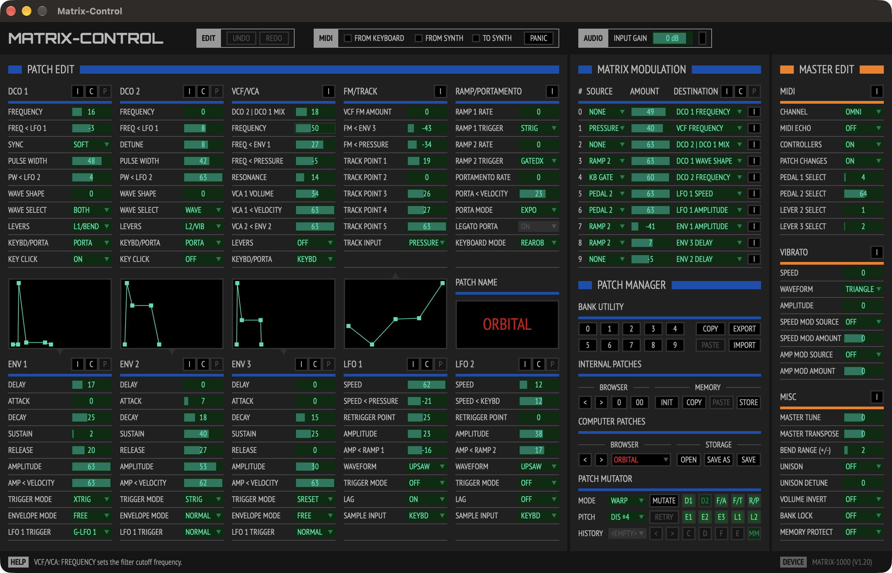
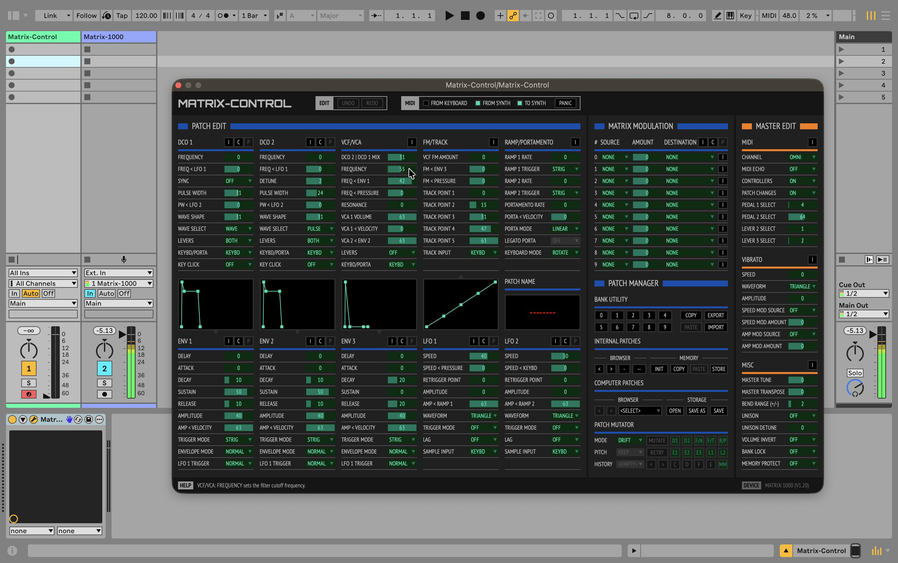
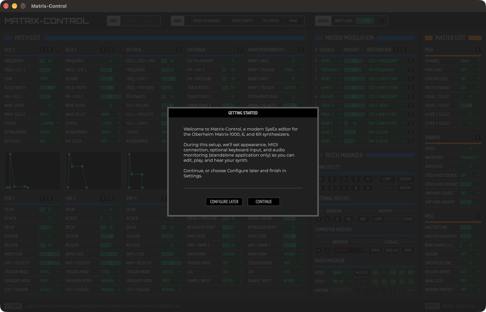
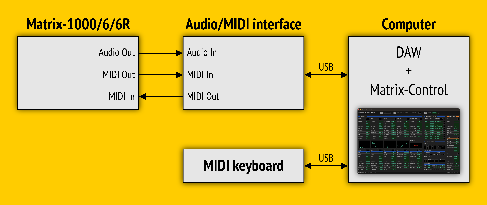

# Matrix-Control — Manuel utilisateur

> **Lexique.** Les termes techniques et acronymes utilisés dans ce manuel sont expliqués en fin de document, dans le [lexique](#lexique). Vous pouvez y revenir à tout moment.

## Table des matières

1. [Oberheim Matrix-1000, Matrix-6 et Matrix-6R](#1-oberheim-matrix-1000-matrix-6-et-matrix-6r)
2. [Qu’est-ce que le Matrix-Control ?](#2-quest-ce-que-le-matrix-control)
3. [Équipements nécessaires pour utiliser le Matrix-Control](#3-équipements-nécessaires-pour-utiliser-le-matrix-control)
4. [Installer et lancer le Matrix-Control](#4-installer-et-lancer-le-matrix-control)
5. [Assistant de premier lancement (GETTING STARTED)](#5-assistant-de-premier-lancement-getting-started)
6. [Connecter le synthé et établir la communication MIDI](#6-connecter-le-synthé-et-établir-la-communication-midi)
7. [Se repérer dans l’écran principal](#7-se-repérer-dans-lécran-principal)
8. [Éditer un patch (PATCH EDIT)](#8-éditer-un-patch-patch-edit)
9. [Éditer la matrice de modulation (MATRIX MODULATION)](#9-éditer-la-matrice-de-modulation-matrix-modulation)
10. [Gérer les patches dans la mémoire du synthé (INTERNAL PATCHES)](#10-gérer-les-patches-dans-la-mémoire-du-synthé-internal-patches)
11. [Gérer les banques du Matrix-1000 (BANK UTILITY)](#11-gérer-les-banques-du-matrix-1000-bank-utility)
12. [Gérer les patches sur l’ordinateur (COMPUTER PATCHES)](#12-gérer-les-patches-sur-lordinateur-computer-patches)
13. [Créer des variations de patch (PATCH MUTATOR)](#13-créer-des-variations-de-patch-patch-mutator)
14. [Gérer les paramètres globaux du synthé (MASTER EDIT)](#14-gérer-les-paramètres-globaux-du-synthé-master-edit)
15. [Sélectionner un Skin et ajuster la taille de la fenêtre (SETTINGS)](#15-sélectionner-un-skin-et-ajuster-la-taille-de-la-fenêtre-settings)
16. [Utiliser l’application autonome et la version plugin](#16-utiliser-lapplication-autonome-et-la-version-plugin)
17. [Guide de dépannage](#17-guide-de-dépannage)
18. [Lexique](#lexique)

## 1. Oberheim Matrix-1000, Matrix-6 et Matrix-6R

Les synthétiseurs Oberheim **Matrix-1000**, **Matrix-6** et **Matrix-6R** forment une même famille. Ils partagent en grande partie la même architecture sonore : deux oscillateurs (DCO), un filtre passe-bas résonant (VCF), deux amplificateurs (VCA), trois enveloppes, deux LFO, une matrice de modulation — le « cœur Matrix » qui a donné son nom à ces machines.

Ce qui change surtout à l’usage :

| | **Matrix-1000** | **Matrix-6/6R** |
|---|-----------------|----------------|
| **Façade** | Non programmable en façade (très peu de boutons) : un éditeur externe devient indispensable | Programmables en façade — version clavier (Matrix-6) ou rack (Matrix-6R) |
| **Mémoire** | **10 banques** (0–9), **100 patches** par banque | **100 patches** seulement (pas de banques) |
| **Réglages globaux (Master)** | Master avec notamment les **Groupes** propres au Matrix-1000 | Master différent sur quelques points ; **pas de Groupes** |
| **Autres écarts** | Pas de mode Split ; sortie audio mono | Mode Split ; sortie audio stéréo ; davantage de commandes directes en façade |

Sur le Matrix-1000, les banques **0** et **1** sont réinscriptibles (mémoire utilisateur). Les banques **2 à 9** sont en lecture seule (mémoire d’usine) : on y consulte les sons d’origine, on ne les écrase pas.

## 2. Qu’est-ce que le Matrix-Control ?

Le **Matrix-Control** est un **éditeur MIDI** moderne conçu pour cette famille de synthétiseurs. Il s’agit d’une refonte complète du module Max for Live *Matrix-1000 Editor* proposé en décembre 2020. Le Matrix-Control a été pensé d’abord pour le **Matrix-1000**, car non programmable en façade. L’éditeur est également très utile aux possesseurs de **Matrix-6** et **Matrix-6R**, qui partagent pour l’essentiel la même architecture.

Le Matrix-Control ne produit pas le son : celui-ci est toujours généré par votre synthé. L’éditeur agit comme une télécommande à l’écran — boutons, curseurs, menus et afficheurs — en échangeant des messages MIDI « System Exclusive » (SysEx) avec la machine. Le chemin audio (sortie du synthé vers votre écoute) se règle côté matériel ; le détail figure à la [section 6](#6-connecter-le-synthé-et-établir-la-communication-midi).

Vous pouvez l’utiliser :

- **En application autonome** (Standalone), sans DAW
- **Dans un DAW** (Ableton Live, Logic Pro, Reason Studios, Bitwig Studio, Cubase, Reaper, GarageBand, etc.), comme instrument virtuel (plugin) qui communique avec le synthé

Dès que les connexions MIDI sont opérationnelles, le Matrix-Control demande au synthé de s’identifier. En bas à droite, le badge `DEVICE` affiche alors le type de machine détectée, ou `NOT CONNECTED` si la communication n’est pas encore établie.

> **À noter.** Un Matrix-6R peut pour l’instant apparaître simplement comme « Matrix-6 ». Cela n'a pas d’incidence sur l’édition d’un patch.

Pour les crédits et les contacts : cliquez sur le logo `MATRIX-CONTROL` puis le menu `ABOUT…`.

### Présentation de la fenêtre principale

Dès l’ouverture, la fenêtre se découpe en trois panneaux — voici un plan simple pour nommer ce que vous voyez à l'écran, avant d’entrer dans le détail :

```
+--------------------------------------------------------------------+
| Logo MATRIX-CONTROL | Undo/Redo, LEDs MIDI (FROM/TO SYNTH, etc.)   | <- HEADER
+--------------------------------------------------------------------+
|                     |                        |                     |
| PATCH EDIT          | MATRIX MODULATION      | MASTER EDIT         |
| - 10 modules son :  | (10 bus de modulation) | (Matrix-1000        |
|   DCO, VCF, ENV…    |------------------------|  uniquement ; grisé |
| - 5 afficheurs :    | PATCH MANAGER          |  sur Matrix-6/6R)   | <- BODY
|   - 3 Enveloppes    | - INTERNAL PATCHES     |                     |
|   - 1 Track Gen.    | - COMPUTER PATCHES     |                     |
|   - 1 PATCH NAME    | - BANK UTILITY         |                     |
|                     | - PATCH MUTATOR        |                     |
+--------------------------------------------------------------------+
| Messages/aide utilisateur            Badge DEVICE (type de synthé) | <- FOOTER
+--------------------------------------------------------------------+
```

En haut, le `HEADER` ; au centre, le panneau principal `BODY` (structuré en trois colonnes d’édition) ; en bas, le `FOOTER` (messages / aide et badge `DEVICE`). La capture ci-dessous montre le rendu à l’écran ; le parcours détaillé de chaque zone est dans la [section 7](#7-se-repérer-dans-lécran-principal).

<div align="center">

<br />
<em>Fenêtre principale du Matrix-Control avec un synthé Oberheim Matrix-1000 détecté.</em>
</div>

## 3. Équipements nécessaires pour utiliser le Matrix-Control

### Matériel

- Un synthétiseur Oberheim **Matrix-1000**, **Matrix-6** ou **Matrix-6R**
- Une interface MIDI : boîtier USB-MIDI dédié, ou interface audio équipée de connecteurs MIDI au format DIN 5 broches, selon votre installation
- **Deux câbles MIDI** pour une communication **bidirectionnelle** (ordinateur ↔ synthé) :
  - De l’ordinateur **vers** le synthé (pour transmettre les patches et les réglages globaux « Master »)
  - Du synthé **vers** l’ordinateur (afin que le Matrix-Control puisse reconnaître la machine, lire le patch courant, etc.)
- Un **chemin audio** : sortie du synthé vers une entrée d’interface audio, une table de mixage ou des enceintes (schéma et réglages à la [section 6](#6-connecter-le-synthé-et-établir-la-communication-midi))

### Ordinateur

| Système | Ce que vous pouvez installer |
|---------|------------------------------|
| **macOS** (Apple Silicon ou Intel) | Application autonome, plugin VST3, plugin AU |
| **Windows** 10 ou 11 | Application autonome, plugin VST3 |
| **Linux** (Ubuntu 24.x / 26.x ou proche) | Application autonome, plugin VST3 |

### Logiciels

- Le Matrix-Control (application autonome et / ou plugins fournis avec votre téléchargement)
- **Soit** uniquement l’application autonome — un DAW n’est alors **pas** nécessaire
- **Soit** un DAW (Ableton Live, Bitwig Studio, Logic Pro, Cubase, Reason, Reaper, GarageBand, etc.) si vous voulez utiliser le plugin VST3 ou AU

### Pour démarrer sereinement

- Savoir lancer une application, **ou** ouvrir un instrument virtuel dans votre DAW si vous utilisez la version plugin
- L’interface du Matrix-Control est en **anglais** : ce manuel traduit et explique chaque section au fil de la lecture

## 4. Installer et lancer le Matrix-Control

Idéalement, réalisez le câblage MIDI et audio **avant** le premier lancement — voir [section 6](#6-connecter-le-synthé-et-établir-la-communication-midi). Vous pourrez aussi le finaliser pendant l’assistant `GETTING STARTED`.

### Télécharger et installer le logiciel

Le Matrix-Control se télécharge sous la forme d'un fichier ZIP comprenant une application autonome et les plugins compatibles avec votre système d'exploitation, accompagnés de la documentation utilisateur :

- **Application autonome** — l’application Matrix-Control, à lancer comme n’importe quel autre logiciel
- **Plugin VST3** (macOS, Windows, Linux) — à placer dans le dossier VST3 habituel de votre système
- **Plugin AU** (macOS uniquement) — à placer dans le dossier des composants Audio Units (en général celui proposé par l’installeur ou indiqué dans les instructions du téléchargement)

Si la version plugin n’apparaît pas dans votre DAW, rescannez la liste des plugins et vérifiez que les fichiers ont bien été installés dans le dossier attendu (voir aussi les instructions fournies avec le téléchargement).

### En application autonome

1. Lancez l’application **Matrix-Control**
2. Au premier lancement, l’assistant `GETTING STARTED` s’ouvre automatiquement et vous guide (réglages de l'apparence graphique, taille de fenêtre, ports MIDI, clavier maître éventuel, écoute audio) — voir [section 5](#5-assistant-de-premier-lancement-getting-started)
3. Vous pourrez ensuite ajuster les réglages MIDI dans `SETTINGS…` → `MIDI & DEVICE`, et les réglages audio dans `SETTINGS…` → `AUDIO`

### Dans un DAW

1. Créez une piste **MIDI / instrument**
2. Chargez le **Matrix-Control** comme instrument virtuel
3. Au premier lancement, l’assistant `GETTING STARTED` s’ouvre automatiquement pour vous guider (voir [section 5](#5-assistant-de-premier-lancement-getting-started))
4. Assurez-vous que la piste peut envoyer et recevoir du MIDI vers / depuis votre interface (selon votre DAW)
5. Pour l’écoute du synthé : une **piste audio** séparée — détail et exemples par DAW à la [section 6](#jouer-et-éditer-dans-un-daw)

<div align="center">

<br />
<em>Le Matrix-Control chargé comme instrument virtuel dans un DAW (ici, Ableton Live).</em>
</div>

## 5. Assistant de premier lancement (GETTING STARTED)

Au premier lancement, le Matrix-Control ouvre automatiquement l’assistant **`GETTING STARTED`**. Il est organisé en plusieurs étapes et vous aide à poser l’essentiel avant d’éditer : taille de la fenêtre (`UI SCALE`), apparence graphique (`SKIN`), ports MIDI vers / depuis le synthé, clavier maître éventuel, et — en application autonome — écoute audio. Rien n’est définitif : vous pourrez tout revoir ensuite dans `SETTINGS…`.

<div align="center">

<br />
<em>Fenêtre <code>GETTING STARTED</code> à l’étape d’introduction.</em>
</div>

### Étapes de configuration

L’écran d’accueil de l'assistant propose un bouton `CONTINUE` pour démarrer les réglages (recommandé), et un bouton `CONFIGURE LATER` si vous préférez configurer plus tard. Puis l’assistant enchaîne :

| Étape | À l’écran | Ce que vous faites |
|-------|-----------|--------------------|
| 1 | `USER INTERFACE` | Choisir une taille de fenêtre (`UI SCALE`) et une apparence graphique (`SKIN`) |
| 2 | `SYNTH COMMUNICATION` | Sélectionner les ports MIDI pour une communication bidirectionnelle avec le synthé (`SYNTH FROM` / `SYNTH TO`) |
| 3 | `MIDI KEYBOARD` | Sélectionner un clavier maître MIDI (facultatif, détail ci-dessous) |
| 4 | `AUDIO` | **Application autonome seulement** — choisir une interface audio et une entrée pour entendre le synthé |

Dans la version plugin, l’assistant s’arrête après l’étape clavier : le DAW gère déjà l’audio de la session (écoute du synthé : [section 6](#jouer-et-éditer-dans-un-daw)).

Après l’introduction, naviguez avec `PREVIOUS` et `NEXT`, puis `FINISH` à la dernière étape. Vous pouvez avancer même si le synthé n’est pas encore reconnu : le câblage et les ports se finalisent à la [section 6](#6-connecter-le-synthé-et-établir-la-communication-midi) et dans Settings.

### Clavier maître

- **Application autonome :** la liste `KEYBOARD FROM` sert à choisir le port MIDI d’un clavier maître. Si vous jouez sur le clavier d’un Matrix-6, ou si vous ne souhaitez pas utiliser de clavier maître, utilisez `SKIP`
- **Version plugin :** les notes MIDI proviennent du DAW (`KEYBOARD FROM` est fixé à `HOST`). Des exemples de branchement figurent plus loin — voir [Jouer et éditer dans un DAW](#jouer-et-éditer-dans-un-daw)

### Plus tard, ou à nouveau

`CONFIGURE LATER` ferme l’assistant : vous terminez la configuration dans `SETTINGS…` (ports MIDI, apparence, écoute audio en application autonome). Le Matrix-Control peut rappeler l’assistant **une fois** au prochain lancement ; ensuite il ne s’ouvre plus automatiquement.

Pour le relancer, ou pour empêcher qu’il s’ouvre automatiquement : `SETTINGS…` → onglet `GETTING STARTED` → ligne `SETUP WIZARD` (`SHOW WHEN INCOMPLETE`, `NEVER SHOW AT LAUNCH`, ou `RUN SETUP AGAIN`). Les réglages d’apparence se retrouvent aussi dans l’onglet `USER INTERFACE` et le menu du logo `MATRIX-CONTROL` — voir [section 15](#15-sélectionner-un-skin-et-ajuster-la-taille-de-la-fenêtre-settings).

## 6. Connecter le synthé et établir la communication MIDI

C’est l’étape la plus importante côté matériel. Idéalement, faites ce câblage **avant** (ou pendant) le premier lancement : tant que le synthé n’est pas reconnu, une grande partie de l’éditeur reste indisponible (fenêtre grisée) — et sans sortie audio branchée, vous n’entendrez pas vos changements.

### Câblage type

Voici un exemple de branchement courant : le synthé échange le MIDI dans les **deux** sens avec une interface Audio/MIDI, renvoie son audio vers une entrée ligne de cette interface, et l’ordinateur dialogue en USB (DAW + Matrix-Control). Un clavier maître peut se brancher aussi en USB sur l’ordinateur — facultatif, surtout utile en application autonome.

Les connecteurs et les boîtiers dépendent de votre installation ; le schéma proposé donne surtout des repères concernant le **sens** des liaisons à respecter.

<div align="center">

<br />
<em>Exemple de câblage MIDI et audio (clavier maître facultatif).</em>
</div>

Dans l’ordre, côté matériel :

1. **MIDI OUT** de l’interface / de l’ordinateur → **MIDI IN** du synthé
2. **MIDI OUT** du synthé → **MIDI IN** de l’interface / de l’ordinateur (les **deux** sens sont obligatoires)
3. **Sortie audio** du synthé → entrée de votre interface audio, table de mixage ou enceintes
4. Allumez le synthé (et votre interface MIDI / audio si besoin)
5. Vérifiez que le canal MIDI du synthé est cohérent avec celui que vous utiliserez (sur Matrix-1000, vous pourrez aussi le régler dans `MASTER EDIT` → `MIDI` → `CHANNEL`)

### Sélection des ports MIDI

L’assistant `GETTING STARTED` propose déjà ces choix. Ensuite, vous les retrouvez dans `SETTINGS…` → `MIDI & DEVICE`.

| Libellé | Rôle |
|---------|------|
| `SYNTH FROM` | Port MIDI **depuis** le synthé (branché sur son MIDI OUT). Si rien n’est choisi : `NO INPUT` |
| `SYNTH TO` | Port MIDI **vers** le synthé (branché sur son MIDI IN). Si rien n’est choisi : `NO OUTPUT` |
| `KEYBOARD FROM` | En **application autonome** : port du clavier maître. Dans la **version plugin** : fixé à `HOST` (notes via le DAW) |

### Témoins d'activité MIDI

Dans le bandeau du haut (`HEADER`), le groupe `MIDI` comporte des **LEDs** `FROM SYNTH`, `TO SYNTH` et `FROM KEYBOARD` qui clignotent lorsque des messages MIDI circulent. Les mêmes voyants se retrouvent dans `SETTINGS…` → `MIDI & DEVICE` : ils aident à sélectionner les bons ports. Quand le Matrix-Control interroge le synthé à intervalle régulier et que celui-ci répond, ou lorsque vous jouez sur le clavier MIDI, le clignotement confirme que les ports choisis correspondent au matériel branché.

### Persistance des ports MIDI

Le Matrix-Control mémorise les ports choisis et tente de les rouvrir au prochain lancement. Dès qu’ils sont ouverts, il demande au synthé de s’identifier. La liste `EPROM TYPE` suit en général le type reconnu ; un ` *` dans la liste ouverte marque la suggestion automatique.

### Plusieurs instances

Si vous possédez plusieurs machines — par exemple un **Matrix-1000** et un **Matrix-6R**, ou deux **Matrix-1000** — vous pouvez ouvrir **une instance du Matrix-Control par synthé**. Chaque instance doit alors gérer sa propre paire de ports `SYNTH FROM` / `SYNTH TO`, branchée sur **sa** machine. Deux synthés = deux jeux de ports distincts.

### Synthé non détecté

Si aucun appareil n’est reconnu, le bas de fenêtre affiche un message du type :

> *No synth detected - check MIDI cables, Settings > MIDI & DEVICE, and power-cycle your Matrix.*

Les sections d’édition restent alors verrouillées. C’est voulu : le Matrix-Control n’envoie pas de modifications tant que le synthé n’est pas détecté.

### Jouer et éditer dans un DAW

Dans la version plugin, le Matrix-Control se comporte un peu comme un **instrument virtuel** : vous le chargez sur une piste MIDI / instrument, vous jouez depuis le clavier maître quand cette piste est **armée**, et `KEYBOARD FROM` reste sur `HOST`. Particularité importante : le plugin **ne sort pas le son** du synthé — celui-ci arrive sur une **piste audio séparée**, branchée sur la sortie de la machine via votre interface.

Deux flux MIDI coexistent :

- **Jouer** — les notes (et autres messages de jeu tels que les contrôleurs continus ou « CC ») suivent l’armement de la piste Matrix-Control, comme pour un instrument virtuel classique
- **Éditer** — la liaison `SYNTH FROM` / `SYNTH TO` avec le synthé reste **active en permanence**, que la piste soit armée ou non. Vous pouvez donc éditer à l’écran sans vous soucier de l’armement — très pratique au quotidien

Pour l’écoute, réglez la piste audio pour entendre l’entrée en continu. Sous **Ableton Live**, choisissez **Monitor : In**. Dans les autres DAW, cherchez l’équivalent (écoute permanente de l’entrée / input monitoring). Si aucune option de ce type n’existe — ce qui serait étonnant —, maintenez la piste audio armée.

#### Ableton Live

1. Créez une piste **MIDI** (ou Instrument) et chargez le **Matrix-Control**
2. Armez la piste pour jouer (ou activez le monitoring MIDI)
3. Choisissez votre clavier maître comme entrée MIDI, ou laissez « All Ins » si c’est votre unique clavier
4. Créez une piste **audio** branchée sur la sortie du synthé via votre interface, et réglez **Monitor : In**
5. Jouez quand la piste Matrix-Control est armée ; éditez à tout moment grâce à `SYNTH FROM` / `SYNTH TO`

**Image floue sous Windows (VST3).** Si l’interface paraît floue dans Live, désactivez **Auto-Scale Plugin Window** (clic droit sur la barre du device **en bas**, dans la vue Device), puis rechargez le device. Le réglage `UI SCALE` du Matrix-Control est indépendant. L’application autonome reste en général nette sur la même machine. (Rappel aussi en [SETTINGS](#settings) et [Dépannage](#17-guide-de-dépannage).)

#### Reason

1. Créez un device **Instrument** et chargez le **Matrix-Control** en VST3
2. Armez-le pour le jeu en temps réel et choisissez votre clavier comme source MIDI
3. Créez une piste / un device audio branché sur la sortie du synthé, avec une écoute d’entrée permanente si le logiciel le propose
4. Jouez quand le device est armé ; l’édition via `SYNTH FROM` / `SYNTH TO` reste disponible en permanence

#### Logic Pro

1. Créez une piste **Instrument logiciel** et chargez le **Matrix-Control** (AU ou VST3)
2. Choisissez votre clavier comme entrée et activez l’enregistrement / le monitoring de la piste pour jouer
3. Créez une piste audio pour le retour du synthé, avec une écoute d’entrée permanente si le logiciel le propose
4. Jouez quand la piste instrument est armée ; l’édition via `SYNTH FROM` / `SYNTH TO` reste disponible en permanence

> **Capture d’écran — À placer ici**  
> *Légende :* Piste Matrix-Control + piste audio du synthé ; notes selon l’armement, édition MIDI toujours active.

### Windows : port déjà utilisé

Sous Windows, un port MIDI est souvent réservé à une seule application à la fois. Si un autre logiciel l’occupe déjà, fermez-le, ou utilisez un port MIDI virtuel (par exemple loopMIDI) pour partager le flux.

> **Capture d’écran — À placer ici**  
> *Légende :* Ports MIDI correctement choisis, voyants actifs, et type de synthé visible en bas à droite.

## 7. Se repérer dans l’écran principal

Une fois le logiciel ouvert, la fenêtre s’organise ainsi :

```
+--------------------------------------------------------------------+
| Logo MATRIX-CONTROL | Undo/Redo, LEDs MIDI (FROM/TO SYNTH, etc.)   | <- HEADER
+--------------------------------------------------------------------+
|                     |                        |                     |
| PATCH EDIT          | MATRIX MODULATION      | MASTER EDIT         |
| - 10 modules son :  | (10 bus de modulation) | (Matrix-1000        |
|   DCO, VCF, ENV…    |------------------------|  uniquement ; grisé |
| - 5 afficheurs :    | PATCH MANAGER          |  sur Matrix-6/6R)   | <- BODY
|   - 3 Enveloppes    | - INTERNAL PATCHES     |                     |
|   - 1 Track Gen.    | - COMPUTER PATCHES     |                     |
|   - 1 PATCH NAME    | - BANK UTILITY         |                     |
|                     | - PATCH MUTATOR        |                     |
+--------------------------------------------------------------------+
| Messages/aide utilisateur            Badge DEVICE (type de synthé) | <- FOOTER
+--------------------------------------------------------------------+
```

### HEADER

- Logo `MATRIX-CONTROL` (clic → menu : `UI SCALE`, `SKIN`, `SETTINGS…`, `ABOUT…`)
- Undo / Redo, et les voyants MIDI `FROM SYNTH` / `TO SYNTH` / `FROM KEYBOARD`
- En application autonome seulement : `INPUT GAIN` et le monitoring du bandeau (l’interface d’écoute se règle dans `SETTINGS…` → `AUDIO`)

### BODY

Trois colonnes d’édition :

| Colonne | Contenu |
|---------|---------|
| **Gauche — `PATCH EDIT`** | Les modules de synthèse (DCO, VCF, ENV…) et les afficheurs (enveloppes, Track Generator, `PATCH NAME`) |
| **Centre** | `MATRIX MODULATION` (dix bus) au-dessus de `PATCH MANAGER` (`INTERNAL PATCHES`, `COMPUTER PATCHES`, `BANK UTILITY`, `PATCH MUTATOR`) |
| **Droite — `MASTER EDIT`** | Réglages globaux du Matrix-1000 (colonne grisée sur Matrix-6/6R) |

Dans ce manuel, **section** désigne un grand bloc (`PATCH EDIT`, `MATRIX MODULATION`…), **module** un bloc fonctionnel (`DCO 1`, `BANK UTILITY`…), et **afficheur** une zone graphique (enveloppes, Track Generator, `PATCH NAME`). Le reste du vocabulaire est dans le [lexique](#lexique).

### FOOTER

- **À gauche :** messages et, le cas échéant, l’aide contextuelle
- **À droite :** badge `DEVICE` — machine détectée (par ex. Matrix-1000) ou `NOT CONNECTED`

> **Capture d’écran — À placer ici**  
> *Légende :* Vue d’ensemble des trois colonnes et du bandeau du bas.

## 8. Éditer un patch (PATCH EDIT)

Une fois le synthé détecté et un patch chargé (voir [section 10](#10-gérer-les-patches-dans-la-mémoire-du-synthé-internal-patches)), vous travaillez dans la section `PATCH EDIT`.

Chaque mouvement de bouton, de curseur ou de menu est transmis au synthé. Vous entendez le résultat tout de suite sur la machine (et via l’écoute audio en application autonome).

### UNDO / REDO

| Action | macOS | Windows / Linux |
|--------|-------|-----------------|
| Annuler | ⌘Z | Ctrl+Z |
| Rétablir | ⌘⇧Z | Ctrl+Shift+Z |

Ces raccourcis concernent les **réglages** du patch (et du Master / de la matrice). Ils ne remplacent ni l’historique du Patch Mutator, ni le bouton `C` (Compare).

En pratique : un glisser de curseur, un geste sur une enveloppe ou le Track Generator, un `I` / `P` de module, ou un réordonnancement de bus Matrix Mod comptent chacun comme une étape. Charger un autre patch, importer une banque, coller un patch complet, ou lancer `MUTATE` / `RETRY` repart d’une nouvelle base : on ne peut plus annuler « avant » ce point.

`STORE`, `SAVE` / `SAVE AS`, l’import / export de banque et la simple navigation entre patches ne s’annulent pas avec ⌘Z / Ctrl+Z. Pour garder un travail important, utilisez plutôt `STORE`, `SAVE` / `SAVE AS`, ou Compare dans le Mutator.

### Boutons `I` / `C` / `P`

Sur plusieurs modules, l’en-tête propose :

| Bouton | Action |
|--------|--------|
| `I` | Réinitialise le module |
| `C` | Copie ses réglages |
| `P` | Colle les réglages précédemment copiés |

`P` n’est actif que si le presse-papiers convient au module cible. Sinon il est grisé ; un clic affiche alors un message en bas de fenêtre.

Entre deux modules du même type (`LFO` ↔ `LFO`, `DCO` ↔ `DCO`), le collage reprend en général les réglages communs. Les contrôles propres à un seul côté (par ex. `SYNC` sur `DCO 1`, `DETUNE` / `NOISE` sur `DCO 2`, ou certaines modulations locales des LFO) restent tels quels sur la cible — sans message particulier. Un collage **dans le même module** reprend tous ses paramètres.

### PATCH NAME

L’afficheur montre le nom courant (8 caractères). Un **double-clic** permet de le renommer quand le contexte l’autorise — par exemple un fichier Computer Patches, ou un patch en mémoire réinscriptible. Sous Compare, sur une banque ROM 2–9, ou quand les noms matériels Matrix-1000 sont affichés, le double-clic laisse le nom en lecture seule.

Le nom modifié vit d’abord dans l’éditeur. Pour le **garder** : `STORE` (mémoire du synthé) ou `SAVE` / `SAVE AS` (fichier). Ce nom de 8 caractères n’est pas le même objet que le nom de fichier `.syx` sur l’ordinateur.

Après un `INIT`, l’afficheur montre `* INIT *` : remplacez-le avant `STORE` ou `SAVE` / `SAVE AS`. Pour un fichier `.m1kp`, le nom affiché vient du nom de fichier (voir [section 12](#12-gérer-les-patches-sur-lordinateur-computer-patches)).

### Modules de synthèse

`PATCH EDIT` regroupe les briques classiques de la synthèse Oberheim. Les libellés à l’écran sont en anglais ; le [lexique](#lexique) précise les sigles.

- **`DCO 1` et `DCO 2`** — Oscillateurs (formes d’onde de base). `SYNC` n’existe que sur `DCO 1` ; `DETUNE` et `NOISE` sont propres à `DCO 2`
- **`VCF/VCA`** — Filtre (timbre) et volume ; le curseur `DCO 2 | DCO 1 MIX` dose le mélange des deux oscillateurs
- **`FM/TRACK`** — Modulation de fréquence du filtre et Track Generator (courbe selon la note, **éditable à la souris**)
- **`RAMP/PORTAMENTO`** — Rampes, glissando entre notes, mode clavier
- **`ENV 1`, `ENV 2`, `ENV 3`** — Enveloppes dans le temps ; leurs **afficheurs sont éditables à la souris**
- **`LFO 1` et `LFO 2`** — Oscillateurs lents qui animent hauteur, filtre, amplitude, etc.

> **Capture d’écran — À placer ici**  
> *Légende :* Section `PATCH EDIT` avec les modules DCO, `VCF/VCA` (curseur `DCO 2 | DCO 1 MIX`), et un afficheur d’enveloppe éditable.

## 9. Éditer la matrice de modulation (MATRIX MODULATION)

La section `MATRIX MODULATION` est un peu le **centre nerveux** du synthé : c’est là qu’on donne vie aux patches en reliant des sources à des destinations — d’où le nom Matrix.

Elle propose **dix bus** (`0` à `9`). Chaque bus a :

- `SOURCE` — ce qui produit la modulation (enveloppe, LFO, clavier, vélocité, pression, etc., ou `NONE`)
- `AMOUNT` — l’intensité
- `DESTINATION` — le paramètre qui bouge (hauteur, filtre, volume, etc., ou `NONE`)

Vous pouvez aussi réinitialiser un bus (`I`) ou toute la section, copier / coller (`C` / `P` — seulement vers une destination compatible), et **réordonner** les bus par **cliquer-glisser vertical** sur le numéro `#` (départ en gris, arrivée en rouge). Les numéros restent `0`–`9` : ce sont les contenus qui s’échangent.

> **Capture d’écran — À placer ici**  
> *Légende :* Section `MATRIX MODULATION` avec les dix bus SOURCE / AMOUNT / DESTINATION.

## 10. Gérer les patches dans la mémoire du synthé (INTERNAL PATCHES)

Dans `PATCH MANAGER`, deux modules gèrent des **sources de patches** différentes :

- **`INTERNAL PATCHES`** — mémoire du synthé (cette section)
- **`COMPUTER PATCHES`** — fichiers sur l’ordinateur ([section 12](#12-gérer-les-patches-sur-lordinateur-computer-patches))

**Focus de navigation.** Un seul module à la fois contrôle les boutons `<` / `>` et la navigation. Cliquez le **titre** du module voulu : il passe en **rouge**, et les flèches parcourent alors cette source. Au survol, le titre change aussi de couleur pour indiquer qu’il est cliquable. Cliquez l’autre titre pour basculer.

### BROWSER

Avec le focus sur `INTERNAL PATCHES` :

- `<` / `>` : patch précédent / suivant dans la mémoire du synthé
- Numéro de **patch** (0–99) : double-clic pour saisir un numéro
- Numéro de **banque** (Matrix-1000) : changez surtout via `BANK UTILITY` (boutons `0`–`9`). Sur Matrix-6/6R, il n’y a pas de banques

Quand vous changez de patch (ou de banque), le Matrix-Control peut d’abord demander quoi faire des modifications non sauvées (`Unsaved patch` : `Cancel`, `Discard`, ou `Store` / `Save` / `Save As` selon le contexte — réglage `UNSAVED STATE` dans Settings). Puis il bascule sur l’emplacement, **lit** le patch depuis le synthé et l’affiche. Il ne le réécrit pas automatiquement juste après cette lecture.

### MEMORY

| Bouton | Rôle |
|--------|------|
| `INIT` | Réinitialise le patch |
| `COPY` | Copie le patch courant |
| `PASTE` | Colle un patch précédemment copié |
| `STORE` | Enregistre dans l’emplacement courant **du synthé** |

Après `INIT`, le nom devient `* INIT *` : renommez avant `STORE` ou `SAVE` / `SAVE AS` (voir [PATCH NAME](#patch-name)). Sur les banques **2–9** du Matrix-1000, `INIT`, `PASTE` et `STORE` sont grisés.

**Si `STORE` ne produit aucun enregistrement apparent.** Sur Matrix-1000, vérifiez `MEMORY PROTECT` et `BANK LOCK` dans `MASTER EDIT` → `MISC` ([section 14](#14-gérer-les-paramètres-globaux-du-synthé-master-edit)). Sur Matrix-6/6R, mettez surtout l’interrupteur **Memory Protect** à l’arrière de la machine sur Off.

> **Capture d’écran — À placer ici**  
> *Légende :* Module `INTERNAL PATCHES` avec les groupes `BROWSER` et `MEMORY` (titre en rouge = focus de navigation).

## 11. Gérer les banques du Matrix-1000 (BANK UTILITY)

Le module `BANK UTILITY` sert à **changer de banque** sur un Matrix-1000 et à **transférer une banque entière** (copie, collage, import, export).

Sur **Matrix-6/6R**, il n’y a pas de banques : `0`–`9`, `COPY` et `PASTE` sont grisés. `IMPORT` et `EXPORT` restent utiles pour échanger les 100 patches avec un dossier sur l’ordinateur (`PATCHES`).

**Avant d’écrire** (`PASTE`, `IMPORT`), sauvegardez d’abord ce que vous voulez garder — `COMPUTER PATCHES` → `SAVE AS`, ou un `EXPORT` ([section 12](#12-gérer-les-patches-sur-lordinateur-computer-patches)). Ces opérations peuvent écraser la mémoire de la machine.

Pendant une session, pilotez le synthé **depuis le Matrix-Control** plutôt que depuis la façade : un changement de banque ou de `BANK LOCK` sur la machine peut désynchroniser l’écran. `BANK LOCK` se trouve dans `MASTER EDIT` → `MISC`, pas ici.

### Boutons de banque

Sur Matrix-1000, les boutons `0`–`9` sélectionnent la banque active ; le Matrix-Control bascule puis **relit** le patch courant (même confirmation `Unsaved patch` qu’en [section 10](#10-gérer-les-patches-dans-la-mémoire-du-synthé-internal-patches)).

Banques **0** et **1** : écriture possible. Banques **2**–**9** : lecture seule pour collage / import (et pour `INIT` / `PASTE` / `STORE` dans Internal Patches). Vous pouvez toujours les sélectionner, les copier ou les exporter.

### COPY / PASTE

- `COPY` lit la banque sélectionnée depuis le synthé
- `PASTE` l’écrit dans une autre banque **réinscriptible** (`0` ou `1`)

`PASTE` reste grisé s’il n’y a rien de copié, sur une banque ROM, ou si la destination est la même que la source. Une confirmation `Paste bank?` précède l’écriture ; une progression accompagne le transfert.

### IMPORT

Sur Matrix-1000, `IMPORT` remplit la banque RAM sélectionnée (`0` ou `1`). Sur Matrix-6/6R, il écrit les **100 emplacements** de la machine. Choisissez le dossier **qui contient** les fichiers patch (par ex. `BANK 3` ou `PATCHES`), pas le dossier parent au-dessus.

Jusqu’à **100** fichiers valides, dans l’ordre alphabétique : moins de 100 → seuls ces emplacements sont réécrits ; plus de 100 → le surplus est ignoré. Pour charger un seul fichier dans l’éditeur, utilisez `OPEN` dans Computer Patches.

Confirmation `Import bank?`, puis barre de progression. Sur les banques ROM 2–9, `IMPORT` est grisé.

### EXPORT

`EXPORT` enregistre les 100 patches (banque Matrix-1000, ou machine Matrix-6/6R) sur le disque :

1. Choisissez un **dossier parent**
2. Le Matrix-Control crée un sous-dossier `BANK N` (ou `PATCHES` sur Matrix-6/6R)
3. S’il existe déjà : `Replace export folder?` (`CONTINUE` / `CANCEL`)
4. Fichiers du type `P00. NomDuPatch.syx` … `P99.…`

Une progression accompagne l’export ; en cas d’annulation, les fichiers de ce passage ne sont pas conservés.

> **Capture d’écran — À placer ici**  
> *Légende :* Module `BANK UTILITY` avec les boutons `0`–`9`, `COPY`, `PASTE`, `IMPORT` et `EXPORT`.

## 12. Gérer les patches sur l’ordinateur (COMPUTER PATCHES)

Le module `COMPUTER PATCHES` gère les patches **comme fichiers** sur le disque — un patch à la fois. La mémoire du synthé reste du côté `INTERNAL PATCHES` ([section 10](#10-gérer-les-patches-dans-la-mémoire-du-synthé-internal-patches)) : `STORE` écrit dans la machine ; ici, `SAVE` / `SAVE AS` écrivent sur l’ordinateur.

**Conseil.** Avant les gestes qui écrivent dans la machine (`STORE`, Mutator, `PASTE` / `IMPORT` de banque), sauvegardez d’abord sur l’ordinateur les patches que vous souhaitez conserver (`SAVE AS`).

Comme pour Internal Patches : cliquez le **titre** `COMPUTER PATCHES` pour lui donner le focus de navigation (titre en rouge). Les `<` / `>` parcourent alors les fichiers du dossier ouvert, pas la mémoire du synthé.

### Parcourir et enregistrer

| Bouton | Rôle |
|--------|------|
| `OPEN` | Choisir le dossier de patches (fichiers `.syx` et `.m1kp`) |
| `SAVE AS` | Enregistrer sous un nouveau nom `.syx` |
| `SAVE` | Enregistrer en `.syx` (fichier déjà associé, ou même nom de base après un `.m1kp`) |

Vous pouvez aussi **glisser-déposer** un `.syx` ou un `.m1kp` sur la fenêtre. `OPEN` / `SAVE` portent sur un patch à la fois ; pour une **banque entière**, utilisez `BANK UTILITY` ([section 11](#11-gérer-les-banques-du-matrix-1000-bank-utility)).

`SAVE` / `SAVE AS` écrivent **toujours** un `.syx` — jamais une réécriture du `.m1kp` d’origine. Après un `.m1kp`, `SAVE` crée ou met à jour un `.syx` du même nom de base (confirmation s’il existe déjà). Le nom affiché dans `PATCH NAME` pour un `.m1kp` vient du nom de fichier.

Les `.syx` sauvés par le Matrix-Control vont dans le **buffer d’édition** du synthé si vous les renvoyez avec un outil SysEx externe : utiles pour réécouter sans écraser tout de suite un emplacement mémoire. Les fichiers factory / communauté d’un autre format restent acceptés à l’ouverture.

### Nom de fichier et nom interne différents

Au chargement d’un **`.syx`**, la boîte `Patch name mismatch` peut proposer `Internal` (nom dans le fichier), `Filename` (nom du fichier), ou `Cancel`. Cela ne s’applique pas aux `.m1kp`. Le comportement par défaut se règle dans Settings ([section 15](#15-sélectionner-un-skin-et-ajuster-la-taille-de-la-fenêtre-settings)).

> **Capture d’écran — À placer ici**  
> *Légende :* Module `COMPUTER PATCHES` avec `OPEN` / `SAVE AS` / `SAVE` (titre en rouge = focus de navigation).

## 13. Créer des variations de patch (PATCH MUTATOR)

Le `PATCH MUTATOR` crée des variations aléatoires contrôlées du patch courant — utile pour explorer des timbres sans tout régler à la main.

`MUTATE` envoie la variation au synthé. Si le patch de départ vous importe, sauvegardez-le d’abord ([section 12](#12-gérer-les-patches-sur-lordinateur-computer-patches)).

### Réglages

| Contrôle | Rôle |
|----------|------|
| `AMOUNT` | Intensité de la variation (1–100 %) |
| `RANDOM` | Degré d’aléatoire (1–100 %) |
| Commutateurs `D1` `D2` `F/A`… `MM` | Modules inclus dans la mutation |

Au moins **un** commutateur de module doit être activé. L’historique de session peut afficher des libellés du type `M00`, `M00-R01`.

### Actions

| Bouton | Rôle |
|--------|------|
| `MUTATE` | Nouvelle variation, envoyée au synthé |
| `RETRY` | Autre tirage à partir de la même base |
| `HISTORY` + `<` / `>` | Parcourt l’historique de la session |
| `C` (Compare) | Compare avec le départ ; **verrouille** le reste de l’édition tant qu’il est actif |
| `D` / `F` | Supprime l’entrée / vide l’historique |
| `E` | Exporte la session en fichiers `.syx` (à rouvrir via Computer Patches → `OPEN`) |

L’historique ne survit pas à la fermeture de l’application. Des boîtes peuvent apparaître si l’historique est plein, si vous changez de patch sans avoir exporté, ou si le dossier d’export existe déjà.

> **Capture d’écran — À placer ici**  
> *Légende :* Module `PATCH MUTATOR` avec `AMOUNT`, `RANDOM`, commutateurs de modules et boutons `MUTATE` / `RETRY` / `HISTORY`.

## 14. Gérer les paramètres globaux du synthé (MASTER EDIT)

`MASTER EDIT` regroupe les **réglages globaux** du Matrix-1000 : ils concernent la machine entière et s’appliquent à **tous** les patches. La colonne n’est active que lorsqu’un Matrix-1000 est détecté ; sur Matrix-6/6R, elle est grisée.

Trois modules — `MIDI`, `VIBRATO`, `MISC` — avec chacun un `I` pour réinitialiser (confirmation `RESET MASTER MODULE?`). Vous y trouvez notamment le canal MIDI, le vibrato, l’accordage, la transposition, et les protections mémoire.

### Protections mémoire

Dans le module `MISC` :

| Réglage | Effet |
|---------|--------|
| `MEMORY PROTECT` | Empêche d’écrire des patches. Si `STORE` ne produit aucun enregistrement apparent, vérifiez ici d’abord |
| `BANK LOCK` | Verrouille le changement de banque côté Matrix-1000 |

Pour enregistrer, travaillez de préférence sur une banque `0` ou `1`.

**Sur Matrix-6/6R**, mettez l’interrupteur **Memory Protect** à l’arrière de la machine sur Off pour pouvoir `STORE`.

> **Capture d’écran — À placer ici**  
> *Légende :* Section `MASTER EDIT` (modules `MIDI`, `VIBRATO`, `MISC`) sur Matrix-1000.

## 15. Sélectionner un Skin et ajuster la taille de la fenêtre (SETTINGS)

### Menu du logo MATRIX-CONTROL

Un clic sur le logo `MATRIX-CONTROL` (en haut à gauche) ouvre :

| Entrée | Contenu |
|--------|---------|
| `UI SCALE` | Taille de l’interface (50 % à 200 %) |
| `SKIN` | Familles `BLACK`, `CREAM` et `TONES` |
| `SETTINGS…` | Préférences |
| `ABOUT…` | Version, crédits, liens |

Raccourcis utiles sur le logo : double-clic → `UI SCALE` à 100 % ; Shift + clic → `SETTINGS…`. **Échap** ferme en général Settings, About et certains dialogues (dont `GETTING STARTED`).

Raccourcis clavier (éditeur au focus, hors saisie de texte) :

| Action | macOS | Windows / Linux |
|--------|-------|-----------------|
| Ouvrir / ramener `SETTINGS` | ⌘ , | Ctrl+, |
| `UI SCALE` plus grand / plus petit / 100 % | ⌘+ / ⌘- / ⌘0 | Ctrl+Plus / Ctrl+- / Ctrl+0 |
| Skins de base `BLACK/…` et `CREAM/…` | ⌘1 … ⌘6 | Ctrl+1 … Ctrl+6 |
| Cycle dans la famille / toutes les skins | ⌘ + flèches / ⌘⇧ + flèches | Ctrl+flèches / Ctrl+Shift+flèches |

Les raccourcis 1–6 suivent l’ordre de la liste `SKIN` dans Settings. La famille `TONES` (quinze variantes) se choisit dans le sous-menu, ou via les cycles de flèches. Le détail est aussi rappelé dans le menu du logo.

### SETTINGS

Les préférences sont regroupées par onglets.

- **`GETTING STARTED`** — ligne `SETUP WIZARD` : `SHOW WHEN INCOMPLETE` (défaut), `NEVER SHOW AT LAUNCH`, ou `RUN SETUP AGAIN` ([section 5](#5-assistant-de-premier-lancement-getting-started))
- **`USER INTERFACE`** — `UI SCALE`, `SKIN`, `INFO MESSAGE`, `CONTEXTUAL HELP`. Si l’interface VST3 paraît floue dans Ableton Live sous Windows, voyez plutôt Auto-Scale Plugin Window de Live ([Ableton Live](#ableton-live))
- **`MIDI & DEVICE`** — ports `SYNTH FROM` / `SYNTH TO` (`KEYBOARD FROM` en application autonome), badge `DEVICE`, `EPROM TYPE` ; `HARDWARE LATENCY` dans la version plugin seulement
- **`AUDIO`** — **application autonome seulement** : interface / `DRIVER TYPE`, entrées / sorties, canaux d’écoute du retour audio (libellés `SYNTH FROM`), fréquence d’échantillonnage, buffer… (ASIO sous Windows ou JACK sous Linux peuvent apparaître selon votre machine)

Autres réglages utiles : affichage des noms (`MATRIX-1000 PATCHES`, `COMPUTER PATCHES`), avertissement de patch non sauvé (`UNSAVED STATE`), modèles `INIT` patch / Master (`SAVE AS INIT` / `DELETE`), et utilitaires Master (`LOAD` / `SAVE AS` / `INIT`). Préférez ces boutons Settings plutôt que d’éditer à la main les fichiers modèles dans le Finder.

> **Capture d’écran — À placer ici**  
> *Légende :* Onglets Settings (`GETTING STARTED`, `USER INTERFACE`, `MIDI & DEVICE`…) et menu du logo (`UI SCALE`, `SKIN`, six variantes de base + `TONES`).

## 16. Utiliser l’application autonome et la version plugin

Tableau récapitulatif — le détail du câblage et du jeu en DAW est à la [section 6](#6-connecter-le-synthé-et-établir-la-communication-midi).

| Fonction | Application autonome | Version plugin dans le DAW |
|----------|----------------------|--------------------|
| Assistant `GETTING STARTED` | Inclut l’étape Audio | Pas d’étape Audio ; notes via le DAW |
| `KEYBOARD FROM` | Choix d’un port MIDI (ou `SKIP`) | Fixé à `HOST` ([exemples](#jouer-et-éditer-dans-un-daw)) |
| Notes jouées | Port `KEYBOARD FROM` | DAW / clavier vers la piste armée |
| Édition MIDI ↔ synthé | Toujours via `SYNTH FROM` / `SYNTH TO` | Idem — indépendante de l’armement de la piste |
| Écoute du synthé | Settings → `AUDIO` + monitoring dans l’app | Piste audio séparée (ex. Monitor : In sous Live) |
| `INPUT GAIN` / monitoring bandeau | Visibles | Masqués |
| `HARDWARE LATENCY` | Masqué | Visible (Settings → `MIDI & DEVICE`) |

### Ce qui est mémorisé d’une session à l’autre

En général **conservé** : ports MIDI, apparence, taille d’interface, progression `GETTING STARTED`, latence (version plugin), dossier des patches, réglages du Mutator, préférences Settings.

En général **non** conservé tel quel : le patch en cours d’édition (le logiciel se resynchronise avec le synthé quand les ports reviennent), l’historique du Mutator, l’état Compare.

## 17. Guide de dépannage

| Symptôme | Que faire |
|----------|-----------|
| `NOT CONNECTED` / éditeur verrouillé | Vérifier le sens des câbles ; les ports `SYNTH FROM` / `SYNTH TO` (Settings → `MIDI & DEVICE`) ; que le synthé est allumé ; éventuellement l’éteindre puis le rallumer ; sous Windows, s’assurer qu’aucune autre application n’occupe le port |
| Les contrôles bougent mais le patch ne change pas | Vérifier `SYNTH TO` ; le canal MIDI (`MASTER EDIT` sur Matrix-1000) ; `MEMORY PROTECT` / `BANK LOCK` |
| Changement de patch : l’écran ne se met pas à jour | Vérifier le port MIDI `SYNTH FROM` (Settings → `MIDI & DEVICE` ; le synthé doit pouvoir répondre) |
| `STORE` ou `PASTE` grisés | Banque 2–9 sur Matrix-1000 — passer en banque 0 ou 1 |
| `MASTER EDIT` grisé ; banques / `COPY` / `PASTE` de `BANK UTILITY` grisés | Vous êtes sur Matrix-6/6R — `IMPORT` / `EXPORT` restent utilisables tant qu’un appareil est détecté |
| Tout `BANK UTILITY` inutilisable, y compris `IMPORT` / `EXPORT` | Aucun appareil n’est détecté, ou un transfert de banque est déjà en cours |
| Compare empêche toute édition | Cliquer à nouveau sur `C` dans le Mutator |
| Plugin invisible dans le DAW | Rescanner les plugins ; vérifier le format (AU/VST3) et le dossier indiqué avec le téléchargement |
| Pas de notes dans la version plugin | Armer la piste Matrix-Control et router le clavier maître vers elle ([exemples](#jouer-et-éditer-dans-un-daw)) ; `KEYBOARD FROM` reste sur `HOST` |
| Assistant `GETTING STARTED` ne s’ouvre plus | Dans Settings → `GETTING STARTED` → `SETUP WIZARD`, choisir `SHOW WHEN INCOMPLETE` ou cliquer `RUN SETUP AGAIN` |
| Pas de son en application autonome | Vérifier Settings → `AUDIO` (`DRIVER TYPE` / interface, entrée, canaux d’écoute `SYNTH FROM`) et le câblage vers l’interface audio |
| Interface VST3 floue dans Ableton Live (Windows) | Désactiver **Auto-Scale Plugin Window** pour le Matrix-Control, recharger le device ; comparer avec l’application autonome (voir [Ableton Live](#ableton-live)) |
| Deux instances entrent en conflit (détection / édition instable ou incohérente) | Ne pas partager les mêmes ports : une paire `SYNTH FROM` / `SYNTH TO` distincte par instance (et par machine si vous en avez plusieurs) — voir [section 6](#6-connecter-le-synthé-et-établir-la-communication-midi) |
| Audio en retard dans le DAW | Ajuster `HARDWARE LATENCY` dans Settings → `MIDI & DEVICE` (version plugin) ; et la taille de buffer du DAW / de l’interface audio |

## Lexique

Définitions courtes. Les libellés entre guillemets sont ceux de l’écran (anglais).

| Terme | Définition |
|-------|------------|
| **Afficheur** | Région graphique ou panneau d’affichage : enveloppes et Track Generator (éditables à la souris) ; `PATCH NAME` (renommable par double-clic quand l’édition est autorisée — voir [section 8](#patch-name)). |
| **Application autonome** | Logiciel Matrix-Control sans DAW (nommé Standalone une seule fois en introduction). |
| **Standalone** | Voir *Application autonome*. |
| **ASIO** | Sous Windows, type de pilote audio souvent utilisé en MAO (latence en général plus basse). Peut apparaître dans Settings → `AUDIO` → `DRIVER TYPE` en application autonome, selon votre installation. |
| **AU** | Format de plugin sur macOS (Audio Unit). |
| **Banque (Bank)** | Sur le Matrix-1000 : regroupement de 100 patches. Il y a 10 banques (0–9). Le Matrix-6/6R n’a pas de banques. |
| **BANK LOCK** | Dans `MASTER EDIT` → `MISC` : verrouille le changement de banque côté Matrix-1000. |
| **MEMORY PROTECT** | Dans `MASTER EDIT` → `MISC` (Matrix-1000) : empêche d’écrire des patches dans la mémoire du synthé. Sur Matrix-6/6R, l’équivalent se règle surtout à l’arrière de la machine. |
| **DRIVER TYPE** | Dans Settings → `AUDIO` (application autonome) : liste du type de pilote / interface audio (pilote système, ASIO, JACK… selon la plateforme). |
| **Bus de modulation** | Une des dix voies de la section `MATRIX MODULATION` (source, intensité, destination). |
| **DAW** | Digital Audio Workstation — un séquenceur / studio logiciel (Live, Logic, Reaper…). On dit *un* DAW. |
| **DCO** | Oscillateur : source qui produit la forme d’onde de base du patch. |
| **`DCO 2 \| DCO 1 MIX`** | Curseur du module `VCF/VCA` qui dose le mélange entre les deux oscillateurs (libellé à l’écran). |
| **ENV** | Envelope — enveloppe (attaque, decay, sustain, release…) qui façonne l’évolution du patch dans le temps. |
| **FM** | Modulation de fréquence du filtre par l’oscillateur, pour des timbres plus riches ou métalliques. |
| **GETTING STARTED** | Assistant de premier lancement : Skin et taille de fenêtre, ports MIDI vers / depuis le synthé, clavier maître éventuel, et écoute audio en application autonome. S’ouvre au premier lancement ; se relance depuis Settings → `GETTING STARTED` → `SETUP WIZARD`. |
| **Groupe** | Sous-partie d’un module (`BROWSER`, `MEMORY`, `STORAGE`, etc.). |
| **JACK** | Sous Linux, serveur / pilote audio souvent utilisé en MAO. Peut apparaître dans Settings → `AUDIO` → `DRIVER TYPE` en application autonome, selon votre installation. |
| **LFO** | Oscillateur lent : fait vibrer, trembler ou balayer un paramètre. |
| **MASTER** | Réglages globaux de la machine (canal MIDI, vibrato, accordage…), distincts d’un patch. |
| **Matrice de modulation** | Centre nerveux du synthé : tableau de « câbles virtuels » reliant sources et destinations. |
| **MIDI** | Protocole qui permet aux instruments et à l’ordinateur de communiquer (notes, commandes, messages détaillés…). |
| **Module** | Bloc fonctionnel de l’interface (`DCO 1`, `BANK UTILITY`, `PATCH MUTATOR`, etc.). |
| **Modulation** | Faire évoluer automatiquement un paramètre (filtre, volume, hauteur…) à partir d’une source. |
| **Mutator** | Outil qui crée des variations aléatoires contrôlées d’un patch. |
| **Panneau** | Grande région de la fenêtre principale : `HEADER` (bandeau du haut), `BODY` (trois colonnes du centre), `FOOTER` (bandeau du bas). |
| **Patch** | Ensemble des réglages qui définissent un timbre mémorisé (vocabulaire Oberheim). |
| **`PATCH NAME`** | Afficheur du nom de patch (8 caractères). Renommable par double-clic lorsque le contexte l’autorise (voir [section 8](#patch-name)). |
| **Plugin** / **version plugin** | Le Matrix-Control ouvert *dans* un DAW (par opposition à l’application autonome). |
| **Portamento** | Glissando de hauteur entre deux notes. |
| **Presse-papiers** | Mémoire temporaire Copy / Paste *interne* au Matrix-Control (modules ou patches). |
| **Ramp** | Montée progressive utilisable comme source de modulation. |
| **RAM** | Mémoire en lecture/écriture (*Random Access Memory*) dans laquelle on peut stocker ses propres données puis les relire. |
| **ROM** | Mémoire en lecture seule (*Read-Only Memory*), dans laquelle on ne peut pas stocker ses propres données. Sur Matrix-1000, banques 2–9 : pas de `STORE` / `PASTE` / `INIT` depuis l’éditeur. |
| **Section** | Grand ensemble de l’interface (`PATCH EDIT`, `MATRIX MODULATION`, `PATCH MANAGER`, `MASTER EDIT`). |
| **`SKIN`** | Apparence visuelle de l’interface (six variantes de base `BLACK/…` et `CREAM/…`, plus la famille `TONES/…` — menu logo et Settings → `USER INTERFACE`). |
| **STORE** | Enregistrer le patch courant dans la mémoire du synthé. |
| **SYNTH FROM / SYNTH TO** | Ports MIDI vers / depuis le synthé, dans Settings → `MIDI & DEVICE`. Dans le `HEADER`, `FROM SYNTH` / `TO SYNTH` désignent les **voyants** d’activité MIDI. Dans Settings → `AUDIO` (application autonome), `SYNTH FROM` désigne aussi les canaux d’écoute du retour audio. |
| **SysEx** | Messages MIDI détaillés propres à une marque / un modèle, utilisés pour éditer le synthé en profondeur. |
| **`.m1kp`** | Fichier de patch Matrix-Control (chargement via Computer Patches / glisser-déposer). La sauvegarde native reste un `.syx` ; le `.m1kp` d’origine n’est pas réécrit. |
| **`.syx`** | Fichier qui contient un patch au format SysEx. |
| **Track Generator** | Courbe qui transforme la position sur le clavier en valeur de modulation (afficheur interactif). |
| **VCA** | Étage de volume du patch. |
| **VCF** | Filtre qui sculpte le timbre dans le domaine fréquentiel (grave / aigu, résonance). |
| **VST3** | Format de plugin très répandu (Windows, macOS, Linux…). |

*Si quelque chose à l’écran ne correspond pas à ce manuel, notez-le : ce sera le signal pour corriger le document et/ou le logiciel.*
