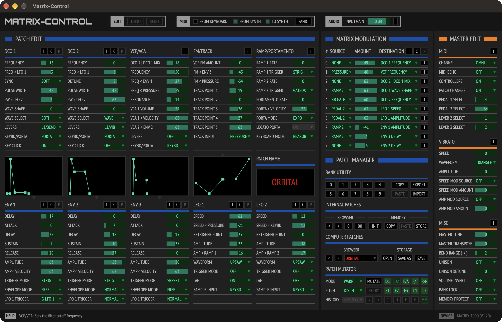

# Matrix-Control — Manuel utilisateur

> **Lexique.** Les termes techniques et acronymes utilisés dans ce manuel sont expliqués en fin de document, dans le [lexique](#lexique). Vous pouvez y revenir à tout moment.

---

## Table des matières

1. [Qu’est-ce que le Matrix-Control ?](#1-quest-ce-que-le-matrix-control)
2. [Équipements nécessaires pour utiliser le Matrix-Control](#2-équipements-nécessaires-pour-utiliser-le-matrix-control)
3. [Synthétiseurs Oberheim Matrix-1000, Matrix-6 et Matrix-6R](#3-synthétiseurs-oberheim-matrix-1000-matrix-6-et-matrix-6r)
4. [Installer et lancer le Matrix-Control](#4-installer-et-lancer-le-matrix-control)
5. [Utiliser l’assistant de premier lancement (GETTING STARTED)](#5-utiliser-lassistant-de-premier-lancement-getting-started)
6. [Connecter le synthé et établir la communication MIDI](#6-connecter-le-synthé-et-établir-la-communication-midi)
7. [Découvrir l’écran principal](#7-découvrir-lécran-principal)
8. [Éditer un patch (PATCH EDIT)](#8-éditer-un-patch-patch-edit)
9. [Éditer la matrice de modulation (MATRIX MODULATION)](#9-éditer-la-matrice-de-modulation-matrix-modulation)
10. [Charger un patch depuis la mémoire du synthé (INTERNAL PATCHES)](#10-charger-un-patch-depuis-la-mémoire-du-synthé-internal-patches)
11. [Gérer les banques du Matrix-1000 (BANK UTILITY)](#11-gérer-les-banques-du-matrix-1000-bank-utility)
12. [Sauvegarder un patch dans la mémoire du synthé et dans l’ordinateur (STORE / COMPUTER PATCHES)](#12-sauvegarder-un-patch-dans-la-mémoire-du-synthé-et-dans-lordinateur-store--computer-patches)
13. [Créer des variations de patch (PATCH MUTATOR)](#13-créer-des-variations-de-patch-patch-mutator)
14. [Gérer les paramètres globaux du synthé (MASTER EDIT)](#14-gérer-les-paramètres-globaux-du-synthé-master-edit)
15. [Sélectionner un Skin et ajuster la taille de la fenêtre (SETTINGS)](#15-sélectionner-un-skin-et-ajuster-la-taille-de-la-fenêtre-settings)
16. [Utiliser l’application autonome et le plugin](#16-utiliser-lapplication-autonome-et-le-plugin)
17. [Guide de dépannage](#17-guide-de-dépannage)
18. [Lexique](#lexique)

---

## 1. Qu’est-ce que le Matrix-Control ?

Le Matrix-Control est un **éditeur MIDI** moderne et très complet, conçu avant tout pour le synthétiseur Oberheim **Matrix-1000**. Il offre aussi une bonne compatibilité avec les **Matrix-6** et **Matrix-6R**, principalement pour l’édition des patches.

Cet éditeur ne produit pas le son lui-même : celui-ci est toujours généré par votre synthétiseur. Le Matrix-Control agit plutôt comme une télécommande sophistiquée : il envoie et reçoit des messages MIDI afin que vous puissiez **visualiser et modifier** les réglages du synthé à l’écran — à l’aide de boutons, curseurs, menus déroulants et afficheurs graphiques.

Sur un **Matrix-6** ou un **Matrix-6R**, c’est une alternative confortable à la programmation depuis la façade, ces modèles étant programmables. Sur un **Matrix-1000**, la façade ne permet pas de programmer les patches : l’éditeur à l’écran devient alors indispensable — et c’est d’ailleurs pour ce synthé très puissant, mais non programmable en façade, que le Matrix-Control a d’abord été conçu.

Pour **entendre** le son produit par le synthé, branchez sa sortie audio vers une entrée de votre interface audio, une table de mixage ou vos enceintes — le Matrix-Control ne remplace pas ce chemin audio et n’enregistre pas le son.

Vous pouvez l’utiliser :

- **Dans un DAW** (Ableton Live, Logic Pro, Reason Studios, Bitwig Studio, Cubase, Reaper, GarageBand, etc.), comme instrument virtuel qui dialogue avec le synthé
- **En application autonome** (`Standalone`), sans DAW — un logiciel de MAO n’est pas obligatoire si vous restez en Standalone

Pour les crédits et les contacts, ouvrez `ABOUT...` depuis le menu du logo `MATRIX-CONTROL`.

<div align="center">

<br />
<em>Fenêtre principale du Matrix-Control avec un synthé Oberheim Matrix-1000 détecté.</em>
</div>


---

## 2. Équipements nécessaires pour utiliser le Matrix-Control

### Matériel

- Un synthétiseur Oberheim **Matrix-1000**, **Matrix-6** ou **Matrix-6R**
- Une interface MIDI : boîtier USB-MIDI dédié, ou interface audio équipée de connecteurs MIDI au format DIN 5 broches, selon votre installation
- **Deux câbles MIDI** pour une communication dans les **deux sens** en même temps (ordinateur ↔ synthé) :
  - De l’ordinateur **vers** le synthé (pour transmettre les patches et les réglages globaux)
  - Du synthé **vers** l’ordinateur (pour que le Matrix-Control lise le patch courant et reconnaisse la machine)
- Un **chemin audio** pour entendre le synthé : sortie audio du synthé vers une entrée d’interface audio, une table de mixage ou des enceintes. Le Matrix-Control pilote uniquement le synthé en MIDI : il ne produit pas le son et ne l’enregistre pas. En plugin, ce retour se route en général sur une **piste audio séparée** du DAW ; en Standalone, l’écoute se règle dans `SETTINGS...` → `AUDIO` (détail en [sections 4](#4-installer-et-lancer-le-matrix-control) et [16](#16-utiliser-lapplication-autonome-et-le-plugin))

Sans ces deux directions MIDI, l’éditeur ne pourra pas piloter le synthé correctement. Sans chemin audio, vous pourrez éditer à l’écran, mais vous n’entendrez pas le résultat.

### Ordinateur

| Système | Ce que vous pouvez installer |
|---------|------------------------------|
| **macOS** (Apple Silicon ou Intel) | Plugin AU, plugin VST3, application Standalone |
| **Windows** 10 ou 11 | Plugin VST3, application Standalone |
| **Linux** (Ubuntu 24.x / 26.x ou proche) | Plugin VST3, application Standalone |

### Logiciels

- Le Matrix-Control (application Standalone et / ou plugins fournis avec votre téléchargement)
- **Soit** uniquement l’application Standalone — un DAW n’est alors **pas** nécessaire
- **Soit** un DAW (Ableton Live, Bitwig Studio, Logic Pro, Cubase, Reason, Reaper, GarageBand, etc.) si vous voulez utiliser le plugin VST3 ou AU

### Pour démarrer sereinement

- Savoir brancher des ports et câbles MIDI IN / MIDI OUT (ou USB-MIDI), et la sortie audio du synthé vers votre écoute
- Savoir ouvrir un instrument virtuel dans votre DAW **si** vous utilisez le plugin, **ou** lancer une application comme n’importe quel autre programme si vous restez en Standalone
- L’interface du Matrix-Control est en **anglais** : ce manuel traduit et explique chaque section, module et groupe

---

## 3. Synthétiseurs Oberheim Matrix-1000, Matrix-6 et Matrix-6R

Ces machines partagent le même genre de « moteur » sonore (deux oscillateurs, un filtre passe-bas résonant, trois enveloppes, deux LFO, une matrice de modulation, etc.). Ce qui change surtout pour vous dans le Matrix-Control :

| | **Matrix-1000** | **Matrix-6/6R** |
|---|-----------------|-----------------|
| Mémoire des patches | **10 banques** (0 à 9), **100 patches** par banque (0 à 99) | **100 patches** seulement (pas de banques) |
| Module `BANK UTILITY` | Actif (banques, `COPY` / `PASTE` / `IMPORT` / `EXPORT`) | Boutons de banque, `COPY` et `PASTE` grisés ; `IMPORT` / `EXPORT` restent utilisables |
| Section `MASTER EDIT` | Active (réglages globaux : canal MIDI, vibrato, accordage…) | Grisée (indisponible) |
| Façade | Non programmable pour les patches (très peu de boutons) : l’éditeur à l’écran est indispensable | Programmables : clavier (Matrix-6) ou rack (Matrix-6R) avec davantage de commandes directes |

**Banques en lecture seule du Matrix-1000 : **Sur le Matrix-1000, les banques **2 à 9** sont en lecture seule (mémoire ROM) pour certaines actions : les boutons `INIT`, `PASTE` et `STORE` y sont indisponibles. Les banques **0** et **1** sont celles dans lesquelles vous pouvez enregistrer vos modifications dans la machine (mémoire RAM).

**Reconnaissance du synthé :** Dès que les ports MIDI sont correctement sélectionnés, le Matrix-Control demande au synthé de s’identifier. En bas à droite de la fenêtre, vous voyez alors le type de machine détecté, ou `NOT CONNECTED` (sous le badge `DEVICE`) s’il n’y a pas encore de dialogue.

> **À noter.** Un Matrix-6R peut pour l’instant apparaître simplement comme Matrix-6. Pour éditer un patch au quotidien, cela ne change presque rien : la sélection de banque et `MASTER EDIT` restent propres au Matrix-1000 (détail de `BANK UTILITY` en [section 11](#11-gérer-les-banques-du-matrix-1000-bank-utility)).

---

## 4. Installer et lancer le Matrix-Control

Avant le premier lancement, branchez de préférence le MIDI (dans les deux sens) et le chemin audio du synthé — voir [section 6](#6-connecter-le-synthé-et-établir-la-communication-midi). Vous pourrez aussi le faire pendant l’assistant `GETTING STARTED`, mais avoir le câblage prêt évite de chercher les ports et l’écoute « à vide ».

### Télécharger et installer

Le Matrix-Control se télécharge sous la forme de fichiers ZIP comprenant une application autonome et les plugins compatibles avec votre système, accompagnés de la documentation utilisateur :

- **Plugin AU** (macOS) — à placer dans le dossier des composants Audio Units (en général celui proposé par l’installateur ou indiqué dans les instructions du téléchargement)
- **Plugin VST3** (macOS, Windows, Linux) — à placer dans le dossier VST3 habituel de votre système
- **Application Standalone** — l’application Matrix-Control, à lancer comme n’importe quel autre programme

Si le plugin n’apparaît pas dans le DAW, rescannez la liste des plugins et vérifiez que les fichiers ont bien été installés dans le dossier attendu (voir aussi les instructions fournies avec le téléchargement).

### Dans un DAW

1. Créez une piste **MIDI / instrument**
2. Chargez le **Matrix-Control** comme instrument virtuel
3. Au premier lancement, l’assistant `GETTING STARTED` peut s’ouvrir automatiquement (voir [section 5](#5-utiliser-lassistant-de-premier-lancement-getting-started))
4. Assurez-vous que la piste peut envoyer et recevoir du MIDI vers / depuis votre interface (selon votre DAW)
5. Le signal audio du synthé doit être branché séparément dans le DAW (connexion à une entrée de votre interface audio, ou retour de table de mixage). Le Matrix-Control ne remplace pas le synthé : il le pilote en MIDI

### En Standalone

1. Lancez l’application **Matrix-Control**
2. Au premier lancement, l’assistant `GETTING STARTED` peut s’ouvrir automatiquement pour l’apparence, le MIDI vers le synthé, le clavier optionnel, puis l’écoute audio (voir [section 5](#5-utiliser-lassistant-de-premier-lancement-getting-started))
3. Vous pourrez ensuite peaufiner le MIDI dans `SETTINGS...` → onglet `MIDI & DEVICE` ou depuis les listes du bandeau supérieur, et l’écoute audio (interface, canaux) dans `SETTINGS...` → onglet `AUDIO`

> **Capture d’écran — À placer ici**  
> *Légende :* Le Matrix-Control chargé comme instrument dans un DAW.

---

## 5. Utiliser l’assistant de premier lancement (GETTING STARTED)

Lorsque des étapes de configuration utiles restent incomplètes, le Matrix-Control peut ouvrir automatiquement l’assistant **`GETTING STARTED`**. C’est le chemin guidé de premier lancement pour débloquer l’édition, le jeu et l’écoute selon le format (plugin ou Standalone).

L’ouverture automatique dépend du réglage `SETUP WIZARD` dans `SETTINGS...` → onglet `GETTING STARTED` (voir plus bas et [section 15](#15-sélectionner-un-skin-et-ajuster-la-taille-de-la-fenêtre-settings)).

Une fois que vous avez quitté l’introduction avec `CONTINUE`, une réouverture automatique reprend à la **première étape applicable encore incomplète** — pas à l’introduction. L’introduction ne revient que lors d’un vrai premier contact, ou après `RUN SETUP AGAIN`.

> **Capture d’écran — À placer ici**  
> *Légende :* Fenêtre `GETTING STARTED` à l’étape d’introduction.

### Parcours commun (plugin et Standalone)

| Étape | Titre à l’écran | Ce que vous réglez |
|-------|-----------------|--------------------|
| 0 | `GETTING STARTED` | Introduction — aucun contrôle, seulement `CONFIGURE LATER` ou `CONTINUE` |
| 1 | `GETTING STARTED | STEP 1: USER INTERFACE` | `UI SCALE` et `SKIN` (lisibilité sur votre écran) |
| 2 | `GETTING STARTED | STEP 2: SYNTH COMMUNICATION` | Ports MIDI vers / depuis le synthé (`SYNTH FROM` / `SYNTH TO`, comme Settings → `MIDI & DEVICE`), badge `DEVICE`, type `EPROM TYPE` |
| 3 | `GETTING STARTED | STEP 3: MIDI KEYBOARD` | Clavier — contenu différent en plugin et en Standalone (voir ci-dessous) |

`CONFIGURE LATER` et `CONTINUE` n’apparaissent que sur l’**introduction**. Les étapes suivantes utilisent `PREVIOUS`, `NEXT`, éventuellement `SKIP` (clavier Standalone), et `FINISH` sur la dernière étape applicable.

Pour l’ouverture automatique et les rappels, `NEXT`, `SKIP` et `FINISH` marquent l’étape courante comme **terminée**. Ce marquage ne vérifie pas que les ports sont choisis, ni que le badge `DEVICE` affiche une machine reconnue : vous pouvez avancer même si le dialogue MIDI n’est pas encore établi, puis finir dans Settings.

### Plugin (VST3 / AU)

En plugin, le DAW gère déjà l’audio de la session. L’assistant **ne propose pas** l’étape Audio.

- Après le clavier (étape 3), le dernier bouton est `FINISH`
- À l’étape clavier, il n’y a **pas** de liste `KEYBOARD FROM` ni de `SKIP` : les notes MIDI arrivent depuis l’hôte (le DAW)
- Le texte à l’écran renvoie à ce manuel pour des exemples de routage du clavier maître — voir [Clavier maître via le DAW](#clavier-maître-via-le-daw-plugin)

### Standalone

En application autonome, l’assistant ajoute une quatrième étape :

| Étape | Titre à l’écran | Ce que vous réglez |
|-------|-----------------|--------------------|
| 4 | `GETTING STARTED | STEP 4: AUDIO` | Interface / entrée audio pour écouter le synthé, et canaux d’écoute `SYNTH FROM` (Settings → `AUDIO` — distincts du port MIDI du même nom) |

- À l’étape clavier : liste `KEYBOARD FROM` ; vous pouvez `SKIP` si vous jouez sur le clavier intégré d’un Matrix-6, ou si vous n’avez pas encore de clavier maître. `SKIP` marque l’étape clavier comme **terminée** pour l’ouverture automatique et les rappels, sans choisir de port
- La dernière étape est l’Audio : `FINISH` ferme l’assistant et marque cette étape comme terminée pour l’ouverture automatique (même si l’écoute n’est pas encore parfaite)
- Les réglages plus fins (fréquence d’échantillonnage, taille de buffer, etc.) restent disponibles ensuite dans `SETTINGS...` → `AUDIO`

### Configurer plus tard

Sur l’introduction, `CONFIGURE LATER` ferme l’assistant sans marquer comme terminées les étapes non visitées. Vous pouvez finir dans `SETTINGS...` (ports MIDI, audio Standalone, apparence).

Comportement de rappel et de silence :

- Le premier `CONFIGURE LATER` **arme un seul rappel** au prochain lancement, pour le **même format** (plugin ou Standalone), s’il reste une étape applicable incomplète. Pendant que ce rappel est armé, l’**autre** format ne s’ouvre pas automatiquement
- Le silence s’installe ensuite dans l’un de ces cas : ce rappel s’est déjà ouvert automatiquement, **ou** vous avez choisi `CONFIGURE LATER` une seconde fois. Plus d’ouverture auto jusqu’à `RUN SETUP AGAIN`, ou jusqu’à ce que vous remettiez la combo sur `SHOW WHEN INCOMPLETE`
- Fermer avec **Échap** ou un clic à l’extérieur **ne compte pas** comme `CONFIGURE LATER` : l’assistant peut encore se rouvrir au prochain lancement selon les règles normales
- **Exception :** une étape qui devient applicable pour la première fois (par exemple le premier passage en Standalone alors que seul l’Audio manque) peut réarmer une ouverture ciblée — **sauf** si la combo est sur `NEVER SHOW AT LAUNCH`, qui bloque toute ouverture automatique

### Relancer ou couper l’ouverture auto (Settings)

Dans `SETTINGS...` → onglet `GETTING STARTED`, la ligne `SETUP WIZARD` propose :

| Contrôle | Rôle |
|----------|------|
| Combo `SHOW WHEN INCOMPLETE` (défaut) | Ouvre l’assistant au lancement s’il reste une étape applicable non faite |
| Combo `NEVER SHOW AT LAUNCH` | Jamais d’ouverture automatique ; uniquement Settings ou `RUN SETUP AGAIN` |
| Bouton `RUN SETUP AGAIN` | Remet à non fait les étapes applicables au format courant et rouvre l’assistant à l’introduction |

`UI SCALE` et `SKIN` se règlent dans l’onglet `USER INTERFACE` ; les raccourcis du menu logo `MATRIX-CONTROL` restent disponibles.

---

## 6. Connecter le synthé et établir la communication MIDI

C’est l’étape la plus importante côté matériel. Idéalement, faites ce câblage **avant** (ou pendant) le premier lancement et l’assistant `GETTING STARTED` : tant que le synthé n’est pas reconnu, une grande partie de l’éditeur demeure verrouillée — et sans chemin audio, vous n’entendrez pas vos changements.

### Câblage type

1. **MIDI OUT de l’interface / de l’ordinateur** → **MIDI IN du synthé**
2. **MIDI OUT du synthé** → **MIDI IN de l’interface / de l’ordinateur** (les **deux** sens MIDI en même temps sont obligatoires)
3. **Sortie audio du synthé** → entrée de votre interface audio, table de mixage ou enceintes (pour entendre le résultat pendant l’édition)
4. Allumez le synthé (et votre interface MIDI / audio si besoin)
5. Vérifiez que le canal MIDI du synthé est cohérent avec celui que vous utiliserez (sur Matrix-1000, une fois connecté, vous pourrez également le régler dans `MASTER EDIT` → `MIDI` → `CHANNEL`)

### Choisir les ports MIDI

Au premier lancement, l’assistant `GETTING STARTED` (étape `SYNTH COMMUNICATION`) vous propose déjà les ports et le type `EPROM TYPE`. Les ports, le badge `DEVICE` et `EPROM TYPE` se règlent aussi à tout moment dans `SETTINGS...` → onglet `MIDI & DEVICE`, ou depuis le bandeau supérieur pour les ports.

Dans la liste déroulante `EPROM TYPE` (assistant et Settings → `MIDI & DEVICE`), la sélection suit automatiquement le type reconnu à l’identification du synthé. Un marqueur ` *` apparaît **uniquement dans la liste ouverte** à droite de cette suggestion (par ex. `TAUNTEK *`, ou `UNKNOWN *` si le firmware n’est pas reconnu). Une fois la liste refermée, le marqueur disparaît. Si vous changez la combo à la main puis reconnectez un autre synthé (ou d’autres ports), une nouvelle identification remet la suggestion à jour.

**Attention au libellé `SYNTH FROM` :** il désigne deux choses selon l’endroit. Dans Settings → `MIDI & DEVICE` (et l’étape synthé de l’assistant), c’est le **port MIDI** qui arrive du synthé. Dans Settings → `AUDIO` (et l’étape Audio Standalone de l’assistant), ce sont les **canaux d’écoute** du retour audio du synthé.

**Dans Settings → `MIDI & DEVICE` :**

| Libellé | Rôle |
|---------|------|
| `SYNTH FROM` | **Port MIDI** : ce que le synthé **envoie** à l’éditeur (réponses, contenu d’un patch). Port branché sur le MIDI OUT du synthé. Si rien n’est choisi : `NO INPUT` |
| `SYNTH TO` | **Port MIDI** : ce que l’éditeur **envoie** au synthé. Port branché sur le MIDI IN du synthé. Si rien n’est choisi : `NO OUTPUT` |
| `KEYBOARD FROM` | Provenance des notes jouées. En **plugin** : fixé à `HOST` (géré par le DAW), non modifiable. En **Standalone** : clavier maître MIDI ou port MIDI |

**Dans le bandeau supérieur**, les mêmes sens MIDI apparaissent sous les libellés `FROM SYNTH`, `TO SYNTH` et `FROM KEYBOARD`.

**Dans l’assistant `GETTING STARTED`**, l’étape communication synthé affiche les mêmes libellés de ports que Settings → `MIDI & DEVICE` (`SYNTH FROM` / `SYNTH TO`), plus le badge `DEVICE` et `EPROM TYPE`.

Des voyants situés à côté des listes clignotent lorsque des messages MIDI circulent.

Il n’existe **pas** de bouton de connexion automatique. En pratique :

- Le logiciel mémorise les ports choisis
- Il tente de les rouvrir au prochain lancement
- Dès que les ports vers / depuis le synthé sont ouverts, il demande au synthé de s’identifier

**Plusieurs instances Matrix-Control.** Si vous ouvrez plusieurs Matrix-Control en même temps (plusieurs pistes plugin, ou plugin + Standalone), **ne partagez pas les mêmes ports MIDI** entre deux instances. En pratique, chaque instance doit avoir sa propre paire `SYNTH FROM` / `SYNTH TO` vers **un** Matrix (1000 ou 6/6R). En Standalone, `KEYBOARD FROM` fait partie du même jeu de ports pour cette instance ; en plugin, `KEYBOARD FROM` reste figé sur `HOST` (le DAW fournit les notes). Si vous pilotez **deux** synthés, prévoyez un jeu de ports distinct par machine. Sinon : messages mélangés, détection instable, édition peu fiable.

### Tant que le synthé n’est pas détecté

Si aucun appareil n’est reconnu, le bas de la fenêtre affiche un message du type :

> *No synth detected - check MIDI cables, Settings > MIDI & DEVICE, and power-cycle your Matrix.*

Les sections d’édition restent alors verrouillées jusqu’à détection. Ce comportement est voulu : le Matrix-Control n’envoie pas de changements à l’aveugle.

### Clavier maître via le DAW (plugin)

Lorsque le Matrix-Control tourne **en plugin**, les notes MIDI ne se choisissent pas dans la fenêtre de l’éditeur : elles viennent de l’hôte. Routez votre clavier maître (ou l’entrée MIDI du DAW) vers la piste qui charge le Matrix-Control. L’audio du synthé, lui, revient toujours par votre interface audio / une piste audio du DAW — c’est un chemin séparé du MIDI d’édition.

Voici des exemples concrets pour trois hôtes courants. L’idée est la même dans Cubase, Reaper, GarageBand, etc. : piste instrument → Matrix-Control → entrée MIDI / clavier armé vers cette piste.

#### Ableton Live

1. Créez une piste **MIDI** (ou Instrument)
2. Chargez le **Matrix-Control** dans le rack d’instruments de cette piste
3. Armez la piste pour l’enregistrement (bouton Arm), ou activez le monitoring MIDI selon votre préférence Live
4. Sélectionnez votre clavier maître comme entrée MIDI de la piste (liste déroulante d’entrée), ou laissez « All Ins » si un seul clavier est branché
5. Jouez : les notes doivent atteindre le Matrix-Control (`KEYBOARD FROM` reste sur `HOST`)
6. Pour **entendre** le synthé, créez une piste audio (ou utilisez une entrée déjà routée) branchée sur la sortie du Matrix via votre interface audio — ce n’est pas le Matrix-Control qui génère le son

**Windows et image floue (VST3).** Sous Windows, Ableton Live propose une option **Auto-Scale Plugin Window**. Quand elle est activée, l’interface du Matrix-Control en **VST3** peut apparaître floue, **quel que soit** le réglage `UI SCALE` dans le Matrix-Control. Ce n’est pas un défaut de l’échelle interne du plugin : Live redimensionne l’image à sa façon. L’application **Standalone** reste en général nette sur la même machine. Sous macOS, cette option n’existe pas dans Live. (Rappel aussi dans [Settings / `UI SCALE`](#fenêtre-settings) et [Dépannage](#17-guide-de-dépannage).)

Pour les plugins VST3 librement redimensionnables (dont le Matrix-Control), le conseil Ableton est de **désactiver** Auto-Scale Plugin Window, puis de **recharger** le device. En pratique : chargez d’abord le Matrix-Control sur une piste, faites un clic droit sur la barre de titre du device **en bas, dans la vue Device** (pas seulement sur la fenêtre flottante du plugin) pour décocher l’option, rechargez le device, et vérifiez que l’interface est nette.

#### Reason

1. Créez une piste / un device **Instrument** (ou un rack instrument)
2. Chargez le **Matrix-Control** en **VST3** sur ce device
3. Sélectionnez le device Matrix-Control et armez-le pour le jeu en temps réel (entrée MIDI active)
4. Choisissez votre clavier maître comme source MIDI de ce device (ou l’entrée MIDI par défaut s’il n’y en a qu’un)
5. Jouez : les notes doivent atteindre le Matrix-Control (`KEYBOARD FROM` reste sur `HOST`)
6. Pour **entendre** le synthé, créez une piste / un device audio branché sur la sortie du Matrix via votre interface audio — ce n’est pas le Matrix-Control qui génère le son

#### Logic Pro

1. Créez une piste **Instrument logiciel**
2. Chargez le **Matrix-Control** (AU ou VST3) sur cette piste
3. Dans l’inspecteur de piste, choisissez votre clavier / interface MIDI comme entrée, ou laissez l’entrée par défaut si un seul contrôleur est actif
4. Activez l’enregistrement / le monitoring de la piste (bouton R / I selon votre habitude) pour que le clavier joue vers le Matrix-Control
5. Jouez : `KEYBOARD FROM` reste sur `HOST` dans le Matrix-Control
6. Créez une piste audio (entrée de l’interface) pour le retour sonore du synthé — le plugin édite en MIDI, il ne remplace pas la prise audio

> **Capture d’écran — À placer ici**  
> *Légende :* Dans un DAW, clavier maître routé vers la piste qui charge le Matrix-Control (notes vers le plugin ; audio du synthé sur une piste séparée).

### Windows : port déjà utilisé

Sous Windows, un port MIDI est souvent réservé à une seule application à la fois. Si un autre logiciel (ou le DAW) l’occupe déjà, le Matrix-Control peut indiquer qu’il n’a pas pu l’ouvrir. Fermez alors l’autre application, ou utilisez un port MIDI virtuel (par exemple loopMIDI) afin de partager le flux.

> **Capture d’écran — À placer ici**  
> *Légende :* Ports MIDI correctement choisis, voyants actifs, et type de synthé visible en bas à droite.

---

## 7. Découvrir l’écran principal

Une fois le logiciel ouvert, l’interface graphique du Matrix-Control s’organise à peu près ainsi :

```
+--------------------------------------------------------------------+
| Logo MATRIX-CONTROL | Undo/Redo, LEDs MIDI (FROM/TO SYNTH, etc.)   | <- HEADER
+--------------------------------------------------------------------+
|                     |                        |                     |
| PATCH EDIT          | MATRIX MODULATION      | MASTER EDIT         |
| - 10 modules son :  | (10 bus de modulation) | (Matrix-1000        |
|   DCO, VCF, ENV…    |------------------------|  uniquement ; grisé |
| - 5 afficheurs :    | PATCH MANAGER          |  sur Matrix-6/6R)   | <- BODY
|   - 3 Enveloppes    | - INTERNAL PATCHES     |                     |
|   - 1 Track Gen.    | - COMPUTER PATCHES     |                     |
|   - 1 PATCH NAME    | - BANK UTILITY         |                     |
|                     | - PATCH MUTATOR        |                     |
+--------------------------------------------------------------------+
| Messages/aide utilisateur            Badge DEVICE (type de synthé) | <- FOOTER
+--------------------------------------------------------------------+
```

### En haut (`HEADER`)

- Logo `MATRIX-CONTROL` (clic → menu : `UI SCALE`, `SKIN`, `SETTINGS...`, `ABOUT...`)
- Undo / Redo, et les voyants MIDI à côté des listes `FROM SYNTH` / `TO SYNTH` / `FROM KEYBOARD`
- En Standalone uniquement : `INPUT GAIN` et le monitoring audio du bandeau ; la source d’écoute et l’interface se règlent dans `SETTINGS...` → `AUDIO`

### Au centre (`BODY`) — trois colonnes

Dans ce manuel, nous désignons les grands blocs de l’interface comme suit :

- **Panneau** — grandes régions de la fenêtre principale (`HEADER`, `BODY`, `FOOTER`)
- **Section** — `PATCH EDIT`, `MATRIX MODULATION`, `PATCH MANAGER`, `MASTER EDIT`
- **Module** — par exemple `DCO 1`, `BANK UTILITY`, `PATCH MUTATOR`
- **Bus de modulation** — chacune des dix voies de `MATRIX MODULATION`
- **Groupe** — sous-partie d’un module, par exemple `BROWSER` ou `MEMORY`
- **Afficheur** — représentations graphiques (enveloppes et Track Generator, éditables à la souris) ou panneau `PATCH NAME` (renommable par double-clic quand l’édition est autorisée — voir [`PATCH NAME`](#nom-du-patch-patch-name))

| Colonne | Contenu |
|---------|---------|
| **Gauche — section `PATCH EDIT`** | Dix modules de synthèse (DCO, VCF, ENV…) et cinq afficheurs (trois enveloppes, Track Generator, `PATCH NAME`) |
| **Centre** | Section `MATRIX MODULATION` (dix bus) au-dessus de `PATCH MANAGER` (`INTERNAL PATCHES`, `COMPUTER PATCHES`, `BANK UTILITY`, `PATCH MUTATOR`) |
| **Droite — section `MASTER EDIT`** | Réglages globaux du Matrix-1000 (grisée sur Matrix-6/6R) |

### En bas (`FOOTER`)

- **À gauche :** messages d’information, de succès, d’avertissement ou d’erreur (icônes ℹ ✓ ⚠ ✗), et l’aide contextuelle le cas échéant
- **À droite :** badge `DEVICE` — machine détectée (par ex. Matrix-1000) ou `NOT CONNECTED`

> **Capture d’écran — À placer ici**  
> *Légende :* Vue d’ensemble des trois colonnes et du bandeau du bas.

---

## 8. Éditer un patch (PATCH EDIT)

Une fois le synthé détecté et un patch chargé (voir [section 10](#10-charger-un-patch-depuis-la-mémoire-du-synthé-internal-patches)), vous travaillez dans la section `PATCH EDIT`.

### Principe

Chaque mouvement de bouton, de curseur ou de menu déroulant est transmis au synthé. Vous entendez immédiatement le résultat sur la machine (et éventuellement via l’entrée audio en Standalone).

### Annuler / rétablir (`UNDO` / `REDO`)

| Action | macOS | Windows / Linux |
|--------|-------|-----------------|
| Annuler la dernière modification | ⌘Z | Ctrl+Z |
| Rétablir | ⌘⇧Z | Ctrl+Shift+Z |

Ces raccourcis annulent ou rétablissent la **dernière modification éditoriale** du patch (paramètres patch, paramètres master, Matrix Mod). Ils ne remplacent pas l’historique du Patch Mutator ni le bouton `C` (Compare).

**Nouvelle baseline :** charger un patch (synthé ou fichier), naviguer vers un autre patch dans Internal Patches, importer une banque, coller un patch complet (Internal Patches), ou lancer `MUTATE` / `RETRY` dans le Patch Mutator efface l’historique d’annulation éditoriale : l’état affiché devient la nouvelle référence (on ne peut plus annuler avant ce point).

**Groupement :** un glisser de curseur à la souris = une étape d’annulation. Les flèches du clavier sur un curseur focalisé sont groupées : toutes les pressions jusqu’à la perte de focus forment une seule étape (pas une étape par flèche). Un drag interactif sur une enveloppe ou le Track Generator = une étape (tous les paramètres touchés pendant le geste). Les boutons `I` (Init module) et `P` (Paste module) sur un module = chacun une étape. Un réordonnancement complet d’un bus Matrix Mod (glisser-déposer) = une étape.

**Indicateur « patch modifié » :** si vous annulez jusqu’à retrouver l’état du chargement, l’indicateur redevient propre ; s’il reste une différence, il reste affiché.

**Profondeur :** l’historique conserve jusqu’à 100 étapes d’édition ; les plus anciennes sont effacées au-delà.

Lorsque l’éditeur Matrix-Control a le focus, le plugin demande le clavier à l’hôte (Standalone et formats AU/VST3) pour que ces raccourcis lui soient livrés. Les raccourcis ne s’appliquent pas pendant la comparaison Patch Mutator (`Compare` actif), dans les champs texte (nom de patch, champs des Settings — l’annulation texte native du système s’applique alors), ni lorsqu’une fenêtre modale bloquante est ouverte (About, confirmation Master INIT, transfert de banque en cours). Dans la fenêtre Settings, les raccourcis patch restent actifs tant qu’aucun champ texte n’a le focus.

**Hors périmètre undo :** `STORE`, `SAVE` / `SAVE AS`, import/export de banque et navigation entre patches ne sont pas annulables par ⌘Z / Ctrl+Z (seuls les changements de paramètres le sont).

Pour sécuriser votre travail sur la durée, utilisez aussi `STORE` (écriture dans la mémoire du synthé), `SAVE` / `SAVE AS` (fichier sur l’ordinateur), ou le bouton `C` (Compare) du module `PATCH MUTATOR` lorsque vous explorez des variations.

### Boutons `I` / `C` / `P`

Sur plusieurs modules, l’en-tête propose trois actions :

| Bouton | Signification | Action |
|--------|---------------|--------|
| `I` | Init | Réinitialise le module avec ses valeurs par défaut |
| `C` | Copy | Copie les valeurs des paramètres du module |
| `P` | Paste | Colle les valeurs précédemment copiées dans ce module |

Le bouton `P` n’est actif que lorsque le contenu du presse-papiers est compatible avec le module cible. Dans le cas contraire, il apparaît grisé ; un clic sur ce bouton grisé affiche en bas de fenêtre un message du type *Clipboard contents are not compatible with this module.* Ce message concerne l’**incompatibilité totale** (mauvais type de module) : ce n’est pas une explication des subtilités de collage décrites juste en dessous.

**Collage entre modules du même type, avec nuances.** Quand `P` est actif, un collage d’un `LFO` vers l’autre `LFO`, ou d’un `DCO` vers l’autre `DCO`, copie en général les réglages communs (`SPEED`, `AMPLITUDE`, `WAVEFORM` / `WAVE SELECT`, etc.). En revanche, certains réglages n’existent que d’un côté, ou ne se correspondent pas vraiment : le Matrix-Control les **laisse alors tels quels** sur le module cible. Il n’y a **pas** de message dédié en bas de fenêtre pour ces exceptions — le collage se termine normalement, et vous pouvez vérifier les contrôles concernés à l’œil.

Pour les LFO, ce sont surtout les modulations locales propres à chaque module (par exemple `SPEED < PRESSURE` et `AMP < RAMP 1` sur `LFO 1`, ou `SPEED < KEYBD` et `AMP < RAMP 2` sur `LFO 2`) qui restent inchangées lors d’un collage croisé. Pour les DCO, des contrôles propres à un oscillateur (comme `SYNC` sur `DCO 1` ou `DETUNE` sur `DCO 2`) restent inchangés ; une forme d’onde sans équivalent — notamment `NOISE` sur `WAVE SELECT` de `DCO 2` vers `DCO 1` — n’est pas reportée. Le contrôle `KEYBD/PORTA` peut, lui, être **adapté** quand les options des deux DCO se correspondent (ce n’est pas un simple « laisser tel quel »).

Un collage **dans le même module** (copier `LFO 1` puis coller dans `LFO 1`, idem pour un DCO) reprend **tous** les paramètres de ce module.

### Nom du patch (`PATCH NAME`)

L’afficheur `PATCH NAME` présente le nom du patch courant (8 caractères). Il se met à jour lorsqu’un patch est reçu depuis le synthé, lorsqu’un fichier de patch est ouvert depuis votre ordinateur, ou lorsque vous créez des variantes à l’aide du Patch Mutator.

Quand le renommage est autorisé, un **double-clic** sur l’afficheur ouvre l’édition en place (toujours 8 caractères). Ce n’est **pas** toujours possible : Le Matrix-Control n’autorise le renommage que dans certains contextes. Si l’édition est interdite, le double-clic ne démarre pas la saisie — ce n’est pas un bug, c’est une règle liée au contexte du patch.

Hors mode **Compare** du Patch Mutator, vous pouvez en général renommer lorsque :

- Le patch vient d’un **fichier** sur l’ordinateur (Computer Patches)
- Ou le patch vient de la **mémoire du synthé** sur Matrix-6/6R (pas de banques)
- Ou le patch vient de la **mémoire du synthé** sur Matrix-1000, banques **0** ou **1**, et Settings → `MATRIX-1000 PATCHES` n’est pas sur `DISPLAY HARDWARE NAMES`

Le renommage est **bloqué** lorsque :

- Le mode **Compare** du Patch Mutator est actif (cliquer à nouveau sur `C` pour quitter Compare)
- Le patch courant est en mémoire machine sur une banque **ROM 2–9** du Matrix-1000
- Sur un Matrix-1000 (avec banques), Settings → `MATRIX-1000 PATCHES` est sur `DISPLAY HARDWARE NAMES` et le patch vient de la mémoire machine — les noms matériels ne sont pas durables via SysEx dans ce mode

Le double-clic met à jour le nom **dans l’éditeur** (et peut l’envoyer au synthé pour écoute). Pour le **garder** : utilisez `STORE` si le patch vient de la mémoire machine, ou `SAVE` / `SAVE AS` dans Computer Patches s’il vient d’un fichier. Le nom affiché dans `PATCH NAME` (8 caractères Oberheim) n’est pas le même objet que le nom de fichier `.syx` choisi à l’enregistrement sur l’ordinateur.

Après un `INIT` dans `INTERNAL PATCHES`, l’afficheur montre `* INIT *`. Ce marqueur n’est pas un nom Matrix valide : vous devez le remplacer **avant** un `STORE` dans le synthé, et **avant** un `SAVE` / `SAVE AS` sur l’ordinateur. Un `STORE` dans cet état ouvre directement la saisie du nom ; un `SAVE` / `SAVE AS` refuse l’enregistrement tant que le marqueur reste affiché.

Pour un fichier `.m1kp`, le nom affiché vient **toujours** du nom de fichier (voir [Computer Patches](#module-computer-patches)). Les préférences `DISPLAY…` se règlent dans [section 15](#15-sélectionner-un-skin-et-ajuster-la-taille-de-la-fenêtre-settings).

### Modules de synthèse

La section `PATCH EDIT` regroupe les briques classiques de la synthèse soustractive Oberheim. Les libellés à l’écran sont en anglais ; le [lexique](#lexique) précise les sigles (DCO, VCF, VCA, LFO, ENV, etc.).

- **`DCO 1` et `DCO 2`** — Les oscillateurs produisent les formes d’onde de base à l’origine du patch (hauteur, largeur d’impulsion, forme d’onde, etc.). `SYNC` n’existe que sur `DCO 1` ; `DETUNE` et la forme `NOISE` sont propres à `DCO 2`
- **`VCF/VCA`** — Le filtre (`VCF`) sculpte le timbre dans le domaine fréquentiel (fréquence de coupure, résonance, mélange des oscillateurs via le curseur `DCO 2 | DCO 1 MIX`…) ; le `VCA` pilote le volume et sa réponse à la vélocité ou aux enveloppes
- **`FM/TRACK`** — Module de modulation de fréquence du filtre et générateur de tracking : cinq points définissent une courbe selon la note jouée. L’afficheur du Track Generator est **interactif** : vous pouvez déplacer les points à la souris
- **`RAMP/PORTAMENTO`** — Rampes de modulation et glissando entre les notes (portamento), ainsi que le mode clavier. Si `LEGATO PORTA` et le mode clavier `UNISON` sont incompatibles, un message l’indique en bas de fenêtre
- **`ENV 1`, `ENV 2` et `ENV 3`** — Les trois enveloppes façonnent l’évolution du patch dans le temps (attaque, decay, sustain, release…). Leurs **afficheurs sont éditables à la souris** : vous pouvez manipuler directement la forme graphique
- **`LFO 1` et `LFO 2`** — Oscillateurs lents qui animent hauteur, filtre, amplitude ou d’autres destinations, selon la matrice de modulation et les routages locaux

> **Capture d’écran — À placer ici**  
> *Légende :* Section `PATCH EDIT` avec les modules DCO, `VCF/VCA` (curseur `DCO 2 | DCO 1 MIX`), et un afficheur d’enveloppe éditable.

---

## 9. Éditer la matrice de modulation (MATRIX MODULATION)

La section `MATRIX MODULATION` constitue un peu le **centre nerveux** du synthé. C’est ici que l’on donne vie aux patches, en reliant des sources de modulation à des paramètres de destination — d’où le nom des machines Matrix-1000 et Matrix-6/6R.

Elle propose **dix bus de modulation** numérotés de `0` à `9`.

Chaque bus de modulation possède :

- Un menu déroulant `SOURCE` — vous y définissez le signal qui produit la modulation (enveloppes, LFO, clavier, vélocité, pression, pédales, leviers, etc., ou `NONE`) 
- Un contrôle `AMOUNT` — il détermine l’intensité de la modulation appliquée au paramètre de destination 
- Un menu déroulant `DESTINATION` — vous y choisissez le paramètre du synthé qui reçoit le signal de modulation, ce qui a pour effet de le faire évoluer en temps réel (hauteur, largeur d’impulsion, filtre, volume, enveloppes, LFO, portamento, etc., ou `NONE`)

Vous pouvez également :

- Réinitialiser un bus (`I` sur le bus) ou toute la section 
- Copier / coller la section (`C` / `P`) — là encore, le collage n’est possible que vers une destination compatible 
- **Réordonner** les bus en effectuant un **cliquer-glisser vertical** sur le numéro de bus (`#`). Pendant le geste, le point de départ apparaît en **gris** et le point d’arrivée en **rouge**. Les numéros de bus restent `0` à `9` ; ce sont les contenus (source, amount, destination) qui s’échangent

> **Capture d’écran — À placer ici**  
> *Légende :* Section `MATRIX MODULATION` avec les dix bus SOURCE / AMOUNT / DESTINATION.

---

## 10. Charger un patch depuis la mémoire du synthé (INTERNAL PATCHES)

Dans `PATCH MANAGER` → module `INTERNAL PATCHES` :

### Groupe `BROWSER`

- Boutons `<` et `>` pour passer au patch précédent / suivant
- Numéro de **patch** (0–99) : affiché ; un double-clic permet de saisir directement un numéro
- Numéro de **banque** (Matrix-1000) : affiché ; pour changer de banque, utilisez surtout le module `BANK UTILITY` (boutons `0` à `9`). Sur Matrix-6/6R, la notion de banque n’existe pas

Lorsque vous changez de banque ou de patch, le Matrix-Control :

1. Peut afficher la boîte de dialogue `Unsaved patch` si des modifications n’ont été ni stockées dans le synthé (`STORE`) ni sauvegardées en fichier `.syx` (selon le réglage `UNSAVED STATE` des Settings) — choix `Cancel` pour rester sur le patch courant, `Discard` pour abandonner les modifications et poursuivre, ou `Store` / `Save` / `Save As` selon le contexte pour les conserver avant de changer de patch
2. Demande au synthé de basculer sur cet emplacement 
3. **Lit** le patch depuis le synthé et l’affiche dans l’éditeur 
4. **N’écrit pas** automatiquement ce patch en retour juste après cette lecture

### Groupe `MEMORY`

| Bouton | Rôle |
|--------|------|
| `INIT` | Réinitialise le patch avec ses valeurs par défaut |
| `COPY` | Copie le patch courant |
| `PASTE` | Colle un patch précédemment copié |
| `STORE` | Enregistre le patch dans l’emplacement courant **du synthé** |

Après `INIT`, le nom devient `* INIT *` : renommez le patch avant `STORE`, et avant `SAVE` / `SAVE AS` (voir [Nom du patch](#nom-du-patch-patch-name)).

Sur les banques en lecture seule **2–9** du Matrix-1000, `INIT`, `PASTE` et `STORE` sont indisponibles (contrôles grisés).

**Si `STORE` semble ne rien enregistrer.** Sur un Matrix-1000, vérifiez `MEMORY PROTECT` et `BANK LOCK` dans `MASTER EDIT` → `MISC` (détail en [section 14](#14-gérer-les-paramètres-globaux-du-synthé-master-edit)). Sur un Matrix-6/6R, `MASTER EDIT` est grisé : regardez surtout l’interrupteur **Memory Protect** à l’arrière de la machine (à mettre sur Off pour pouvoir enregistrer), et éventuellement la protection par patch sur la façade.

> **Capture d’écran — À placer ici**  
> *Légende :* Module `INTERNAL PATCHES` avec les groupes `BROWSER` et `MEMORY`.

---

## 11. Gérer les banques du Matrix-1000 (BANK UTILITY)

Le module `BANK UTILITY`, dans la section `PATCH MANAGER`, sert à **changer de banque** sur un Matrix-1000 et à **transférer une banque entière** : copie interne, collage vers une autre banque réinscriptible, import depuis un dossier de fichiers, ou export vers le disque.

Sur un **Matrix-6/6R**, ces modèles n’ont pas de banques : les boutons `0`–`9`, `COPY` et `PASTE` sont grisés. Les boutons `IMPORT` et `EXPORT` restent toutefois utilisables pour échanger les 100 patches de la machine avec un dossier sur l’ordinateur (sous-dossier `PATCHES`).

**Avant d’écrire une banque** (`PASTE`, `IMPORT`), sauvegardez d’abord sur l’ordinateur les patches que vous voulez conserver — par exemple via `COMPUTER PATCHES` → `SAVE AS`, ou un `EXPORT` de banque (voir [section 12](#12-sauvegarder-un-patch-dans-la-mémoire-du-synthé-et-dans-lordinateur-store--computer-patches)). Ces opérations peuvent écraser la mémoire de la machine.

Pendant une session avec le Matrix-Control, pilotez le synthé **via le plugin** plutôt que depuis la façade : un changement de banque ou de `BANK LOCK` sur la machine peut désynchroniser l’écran du Matrix-Control. Le réglage `BANK LOCK` lui-même se trouve dans `MASTER EDIT` → `MISC`, pas dans `BANK UTILITY`.

### Boutons de banque (`0`–`9`)

Sur le Matrix-1000, les boutons `0` à `9` sélectionnent la banque active. Le Matrix-Control demande ensuite au synthé de basculer, puis **relit** le patch courant (avec la même logique de confirmation `Unsaved patch` qu’un changement de patch — voir [section 10](#10-charger-un-patch-depuis-la-mémoire-du-synthé-internal-patches)).

Les banques **0** et **1** sont en mémoire RAM (écriture possible). Les banques **2** à **9** sont en lecture seule (ROM) pour le collage et l’import de banque, ainsi que pour `INIT` / `PASTE` / `STORE` dans `INTERNAL PATCHES`. Vous pouvez toujours **sélectionner**, **copier** ou **exporter** une banque ROM.

### Copier et coller une banque (`COPY` / `PASTE`)

- `COPY` lit la banque sélectionnée depuis le synthé et la place dans le presse-papiers interne du Matrix-Control
- `PASTE` écrit cette banque dans la banque sélectionnée **uniquement si c’est une banque RAM** (`0` ou `1`), et seulement si la destination est **différente** de la banque copiée

`PASTE` reste grisé tant qu’aucune banque n’a été copiée avec succès, sur les banques ROM `2`–`9`, et lorsque la destination est la même banque que la source. Avant d’écraser la destination, le Matrix-Control affiche la confirmation `Paste bank?` (`CONTINUE` / `CANCEL`). Une fenêtre de progression accompagne le transfert ; si vous annulez, le synthé est remis dans l’état précédent autant que possible.

### Importer une banque (`IMPORT`)

Sur le Matrix-1000, `IMPORT` remplit la banque RAM sélectionnée (`0` ou `1`). Sur un Matrix-6/6R, il écrit dans les **100 emplacements** de la machine (pas de choix de banque). Dans les deux cas, vous sélectionnez le dossier **qui contient** les fichiers patch (par exemple un sous-dossier `BANK 3` ou `PATCHES` déjà exporté), pas le dossier parent au-dessus.

Le Matrix-Control prend jusqu’à **100** fichiers valides, dans l’ordre alphabétique. S’il y en a moins, seuls ces emplacements sont réécrits — les autres restent inchangés. S’il y en a plus, les fichiers au-delà du centième sont ignorés. Ce n’est **pas** la même chose que `OPEN` dans `COMPUTER PATCHES`, qui charge **un seul** fichier `.syx` dans l’éditeur sans écrire toute une banque dans le synthé.

Une confirmation `Import bank?` précède l’écriture. Une barre de progression suit ; `CANCEL` tente de restaurer la mémoire telle qu’elle était avant l’import.

Sur les banques ROM `2`–`9` du Matrix-1000, `IMPORT` est indisponible (contrôle grisé ; un message peut l’expliquer en bas de fenêtre).

### Exporter une banque (`EXPORT`)

`EXPORT` enregistre les 100 patches de la banque sélectionnée (ou les 100 patches du Matrix-6/6R) sur le disque :

1. Vous choisissez un **dossier parent** (le Matrix-Control mémorise le dernier emplacement)
2. Il crée un sous-dossier `BANK N` (numéro de la banque) — ou `PATCHES` sur Matrix-6/6R
3. Si ce sous-dossier existe déjà, la boîte `Replace export folder?` propose de le remplacer entièrement (`CONTINUE`) ou d’annuler (`CANCEL`)
4. Les fichiers sont nommés `P00. NomDuPatch.syx` … `P99.…` (ou simplement `P12.syx` si le nom n’est pas utilisable)

Une fenêtre de progression accompagne l’export ; en cas de succès, un message en bas de fenêtre confirme le chemin. Si vous annulez pendant l’export, les fichiers créés pour ce passage ne sont pas conservés.

> **Capture d’écran — À placer ici**  
> *Légende :* Module `BANK UTILITY` avec les boutons `0`–`9`, `COPY`, `PASTE`, `IMPORT` et `EXPORT`.

---

## 12. Sauvegarder un patch dans la mémoire du synthé et dans l’ordinateur (STORE / COMPUTER PATCHES)

Deux emplacements distincts :

| Où | Comment | Ce que cela conserve |
|----|---------|----------------------|
| **Mémoire du synthé** | `STORE` dans `INTERNAL PATCHES` | Le patch dans un emplacement de la machine (banque + numéro, ou numéro 0–99 sur Matrix-6/6R) |
| **Ordinateur** | Module `COMPUTER PATCHES` | Des fichiers `.syx` ou `.m1kp` pour **charger** un patch ; la sauvegarde native du Matrix-Control écrit toujours un `.syx` |

**Conseil.** Si vous tenez à des patches déjà présents dans le synthé, sauvegardez-les d’abord sur l’ordinateur (`COMPUTER PATCHES` → `SAVE AS`, fichiers `.syx`) **avant** les gestes qui écrivent dans la machine : `STORE`, variations du Patch Mutator, `PASTE` / `IMPORT` de banque. C’est le filet le plus simple pour ne pas écraser un son auquel vous tenez.

### Module `COMPUTER PATCHES`

**Groupe `BROWSER`**

- Liste déroulante (`SELECT A PATCH`, noms de fichiers, ou `<EMPTY!>`)
- Boutons `<` / `>` pour parcourir les fichiers du dossier

**Groupe `STORAGE`**

| Bouton | Rôle |
|--------|------|
| `OPEN` | Choisir / ouvrir le dossier de patches sur le disque (liste des `.syx` et `.m1kp`, triée : `INITIAL`, chaque `Mxx` puis ses `Mxx-Ryy`, sinon alphabétique) |
| `SAVE AS` | Enregistrer le patch courant sous un nouveau nom `.syx` |
| `SAVE` | Enregistrer le patch courant en `.syx` (fichier déjà associé, ou même nom de base après un chargement `.m1kp`) |

`OPEN` liste les fichiers `.syx` **et** `.m1kp` du dossier. Vous pouvez aussi **glisser-déposer** un `.syx` ou un `.m1kp` sur la fenêtre pour le charger. `SAVE` et `SAVE AS` écrivent **toujours** un `.syx` au format Edit Buffer (voir ci-dessous) — jamais une réécriture du fichier `.m1kp` d’origine. Ce module ouvre et enregistre **un patch à la fois** : il n’y a pas de tags ni de favoris. Pour importer ou exporter **une banque entière**, utilisez `BANK UTILITY` (voir [section 11](#11-gérer-les-banques-du-matrix-1000-bank-utility)) — ce n’est pas le rôle de `OPEN` / `SAVE`.

Après le chargement d’un `.m1kp`, `SAVE` crée ou met à jour un `.syx` du **même nom de base** dans le dossier. S’il existe déjà, le Matrix-Control demande confirmation (`Overwrite existing .syx?`) : `CONTINUE` remplace ce `.syx` ; `CANCEL` annule la sauvegarde. Le fichier `.m1kp` d’origine n’est pas modifié.

Lors du chargement d’un `.m1kp`, le nom affiché dans `PATCH NAME` vient **toujours** du nom de fichier (les préférences Computer Patches `DISPLAY SYSEX NAMES` / `DISPLAY FILE NAMES` ne s’appliquent pas à ce format).

**Format des fichiers sauvés par le Matrix-Control**

Les fichiers `.syx` enregistrés par `SAVE` / `SAVE AS`, par l’export de banque (`BANK UTILITY` → `EXPORT`) ou par l’export Patch Mutator utilisent le format **Edit Buffer** (opcode SysEx `0x0D`). Sur un Matrix-1000, vous pouvez les réécouter sans risque d’écraser un emplacement RAM : rechargez-les dans le Matrix-Control, ou envoyez-les avec un gestionnaire SysEx (SysEx Librarian, etc.) — le patch ira dans le **buffer d’édition**, pas dans un slot mémoire.

- **Import fichier par fichier** : Le Matrix-Control accepte aussi les fichiers `.syx` **externes** au format classique (opcode `0x01`, factory, communauté, etc.) via `COMPUTER PATCHES`
- **Import / export de banque** (`BANK UTILITY`) : voie dédiée pour écrire volontairement une banque complète (Matrix-1000, banque RAM) ou les 100 patches du Matrix-6/6R (`IMPORT`), ou pour les sauver sur le disque (`EXPORT`)
- **Fichiers tiers en `0x01`** : un renvoi direct via SysEx Librarian écrit dans un **slot Oberheim** (comportement du fichier source, pas du Matrix-Control)

Après un parcours de dossier, le bas de fenêtre peut indiquer combien de fichiers sont valides ou invalides, ou confirmer un chargement / une sauvegarde (`Loaded…`, `Saved…`).

### Lorsque le nom du fichier et le nom interne du patch divergent

Pour un chargement **`.syx`**, la boîte de dialogue `Patch name mismatch` peut proposer :

- `Internal` — conserver le nom contenu dans le fichier `.syx` 
- `Filename` — utiliser le nom du fichier 
- `Cancel` — annuler le chargement

Ce dialogue ne s’applique **pas** au chargement d’un `.m1kp` (le nom vient toujours du fichier). Le comportement par défaut pour les `.syx` se règle dans `SETTINGS` (voir [section 15](#15-sélectionner-un-skin-et-ajuster-la-taille-de-la-fenêtre-settings)).

> **Capture d’écran — À placer ici**  
> *Légende :* Module `COMPUTER PATCHES` avec `OPEN` / `SAVE AS` / `SAVE` et une liste de fichiers `.syx` / `.m1kp`.

---

## 13. Créer des variations de patch (PATCH MUTATOR)

Le module `PATCH MUTATOR` génère des variations aléatoires contrôlées du patch courant — un outil précieux pour explorer des timbres sans tout régler à la main.

`MUTATE` envoie la variation au synthé (dans le buffer d’édition). Si le patch de départ est précieux, sauvegardez-le d’abord sur l’ordinateur ou avec `STORE` dans un emplacement que vous acceptez d’écraser — voir [section 12](#12-sauvegarder-un-patch-dans-la-mémoire-du-synthé-et-dans-lordinateur-store--computer-patches).

### Réglages

| Contrôle | Rôle |
|----------|------|
| `AMOUNT` | Intensité de la variation (1–100 %, défaut 50) |
| `RANDOM` | Degré d’aléatoire (1–100 %, défaut 25) |
| Commutateurs `D1` `D2` `F/A` `F/T` `R/P` `E1` `E2` `E3` `L1` `L2` `MM` | Modules inclus dans la mutation (DCO 1/2, filtre/volume, FM/Track, rampes/portamento, enveloppes, LFO, matrice) |

Les curseurs `AMOUNT` et `RANDOM` couvrent la plage 1–100 %. Pour qu’une mutation s’exécute, **au moins un commutateur de module** doit être activé.

Le Mutator ne modifie pas le nom « officiel » du patch ; l’historique peut toutefois afficher des noms de session du type `M00`, `M00-R01`, etc.

### Actions

| Bouton | Rôle |
|--------|------|
| `MUTATE` | Crée une nouvelle variation de patch et l’envoie au synthé |
| `RETRY` | Effectue un autre tirage à partir de la même variation de départ |
| `HISTORY` + `<` / `>` | Parcourt l’historique des variations de la session |
| `C` (Compare) | Compare avec le patch de départ ; **verrouille** le reste de l’édition tant que Compare demeure actif (un message en bas de fenêtre le rappelle) |
| `D` | Supprime l’entrée sélectionnée |
| `F` | Vide l’historique |
| `E` | Exporte la session en liste plate (`INITIAL.syx`, `M00.syx`, `M00-R00.syx`, …) — à rouvrir via Computer Patches → Open sur ce dossier |

L’historique ne survit pas à la fermeture du projet ou de l’application.

- Si l’historique est plein, la boîte `Mutation history full` propose de le compacter (`Defrag`) ou d’annuler (`Cancel`)
- Si vous changez de patch alors que des variations n’ont pas été exportées, la boîte `Unsaved mutations` propose `Export`, `Discard` ou `Cancel`
- Si un dossier d’export existe déjà, la boîte `Export folder exists` propose `Overwrite`, `Keep both` ou `Cancel`

> **Capture d’écran — À placer ici**  
> *Légende :* Module `PATCH MUTATOR` avec `AMOUNT`, `RANDOM`, commutateurs de modules et boutons `MUTATE` / `RETRY` / `HISTORY`.

---

## 14. Gérer les paramètres globaux du synthé (MASTER EDIT)

La section `MASTER EDIT` regroupe les **paramètres globaux** du Matrix-1000 : des réglages qui concernent la machine entière et s’appliquent donc **à tous les patches**, et non à un seul son.

Elle n’est disponible que lorsqu’un **Matrix-1000** est détecté. Sur Matrix-6/6R, toute la colonne est grisée.

Trois modules composent cette section — `MIDI`, `VIBRATO` et `MISC` — chacun muni d’un bouton `I` pour le réinitialiser. Avant d’appliquer cette réinitialisation, le Matrix-Control affiche la boîte `RESET MASTER MODULE?` (`Reset` / `Cancel`).

En pratique, vous y trouverez notamment le canal MIDI, le vibrato global, l’accordage et la transposition maîtres, ainsi que des options de protection mémoire ou de verrouillage de banque. L’idée maîtresse : ce que vous réglez ici influence le comportement général du synthé, quel que soit le patch chargé.

### Protections mémoire (`MISC`)

Dans le module `MISC` (Matrix-1000), deux interrupteurs protègent la machine :

| Réglage | Effet |
|---------|--------|
| `MEMORY PROTECT` | Empêche d’écrire des patches dans la mémoire du synthé. Si `STORE` semble « ne rien faire », vérifiez d’abord cet interrupteur |
| `BANK LOCK` | Verrouille le changement de banque. Ce n’est **pas** un bouton du module `BANK UTILITY` |

Travaillez de préférence sur une banque réinscriptible (`0` ou `1`) lorsque vous voulez enregistrer.

**Sur Matrix-6/6R**, `MASTER EDIT` est grisé : ces deux réglages ne sont pas éditables dans le Matrix-Control. Pour pouvoir `STORE`, mettez surtout l’interrupteur **Memory Protect** à l’arrière de la machine sur Off, et regardez éventuellement la protection par patch sur la façade.

> **Capture d’écran — À placer ici**  
> *Légende :* Section `MASTER EDIT` (modules `MIDI`, `VIBRATO`, `MISC`) sur Matrix-1000.

---

## 15. Sélectionner un Skin et ajuster la taille de la fenêtre (SETTINGS)

### Menu du logo `MATRIX-CONTROL`

Un clic sur le logo (en haut à gauche) ouvre le menu suivant :

| Entrée | Contenu |
|--------|---------|
| `UI SCALE` | Taille de l’interface : 50 % à 200 % (raccourci ; même réglage que dans Settings) |
| `SKIN` | Familles `BLACK`, `CREAM` et `TONES` : sous-menus pour choisir une variante (même réglage que dans Settings) |
| `SETTINGS...` | Préférences (onglets `GETTING STARTED`, `USER INTERFACE`, `MIDI & DEVICE`, `AUDIO` en Standalone, etc.) |
| `ABOUT...` | Version, crédits, liens |

Raccourcis sur le logo :

| Geste | Effet |
|-------|--------|
| Clic simple | Ouvre le menu du logo |
| Double-clic | Remet `UI SCALE` à 100 % |
| Shift + clic | Ouvre `SETTINGS...` |

Raccourcis clavier (quand l’éditeur a le focus, hors saisie de texte) :

| Action | macOS | Windows / Linux |
|--------|-------|-----------------|
| Ouvrir / ramener `SETTINGS` | ⌘ , | Ctrl+, |
| `UI SCALE` plus grand (cran suivant, 50–200 %) | ⌘+ (aussi ⌘=) | Ctrl+Plus (aussi Ctrl+=) |
| `UI SCALE` plus petit (cran précédent) | ⌘- | Ctrl+- |
| `UI SCALE` à 100 % | ⌘ 0 | Ctrl+0 |
| Skin `BLACK/GREEN` | ⌘ 1 | Ctrl+1 |
| Skin `BLACK/CHROMA` | ⌘ 2 | Ctrl+2 |
| Skin `BLACK/MINIMAL` | ⌘ 3 | Ctrl+3 |
| Skin `CREAM/GREEN` | ⌘ 4 | Ctrl+4 |
| Skin `CREAM/CHROMA` | ⌘ 5 | Ctrl+5 |
| Skin `CREAM/MINIMAL` | ⌘ 6 | Ctrl+6 |
| Cycle skin dans la famille active (haut / gauche = précédente ; bas / droite = suivante) | ⌘ + flèches | Ctrl+flèches |
| Cycle toutes les skins (même sens de flèches) | ⌘ Shift + flèches | Ctrl+Shift+flèches |

Les six raccourcis numériques suivent l’ordre du menu déroulant `SKIN` dans Settings (liste plate). Dans le menu logo, les mêmes variantes apparaissent sous les familles `BLACK` et `CREAM`, avec le raccourci rappelé à côté. La famille `TONES` propose quinze variantes nommées (`TONES/CHERRY` … `TONES/FUCHSIA`) sans raccourci chiffre : choisissez-les dans le sous-menu `TONES`, via le cycle global (⌘/Ctrl+Shift+flèches), ou via le cycle de famille une fois une skin `TONES` déjà active (⌘/Ctrl+flèches).

Ces raccourcis sont aussi rappelés dans le menu du logo.

La touche **Échap** ferme en général les fenêtres `SETTINGS` et `ABOUT`, ainsi que certains dialogues (dont `GETTING STARTED`).

### Fenêtre `SETTINGS`

Les préférences sont regroupées par onglets. L’onglet **`GETTING STARTED`** (premier onglet) contient la ligne `SETUP WIZARD` : combo `SHOW WHEN INCOMPLETE` (défaut) ou `NEVER SHOW AT LAUNCH`, puis bouton `RUN SETUP AGAIN` — voir [section 5](#5-utiliser-lassistant-de-premier-lancement-getting-started).

L’onglet **`USER INTERFACE`** contient, dans cet ordre :

| Réglage | Détail |
|---------|--------|
| `UI SCALE` | Taille de l’interface (50 % à 200 %), aussi accessible depuis le menu logo. Si l’interface VST3 paraît floue **notamment** dans Ableton Live sous Windows, voyez plutôt l’option Auto-Scale Plugin Window de Live ([Ableton Live](#ableton-live)) — ce n’est pas le même réglage que `UI SCALE` |
| `SKIN` | Six variantes de base (`BLACK/GREEN`, `BLACK/CHROMA`, `BLACK/MINIMAL`, `CREAM/GREEN`, `CREAM/CHROMA`, `CREAM/MINIMAL`) plus quinze `TONES/…` (`TONES/CHERRY` … `TONES/FUCHSIA`) ; aussi accessible depuis le menu logo |
| `INFO MESSAGE` | Comportement des messages d’information en bas de fenêtre (`KEEP` / `AUTO CLEAR`) |
| `CONTEXTUAL HELP` | Affiche ou masque l’aide contextuelle furtive (`HELP`) dans le bandeau du bas |

Autres réglages utiles :

| Réglage | Disponible ? | Détail |
|---------|--------------|--------|
| Onglet `MIDI & DEVICE` | Oui | Ports `SYNTH FROM` / `SYNTH TO` (`KEYBOARD FROM` en Standalone), badge `DEVICE` (modèle + version EPROM en lecture seule), `EPROM TYPE` ; `HARDWARE LATENCY` (**plugin seulement**, 0 à 200 ms) pour indiquer au DAW le retard du chemin matériel (synthé + câbles + interface audio) |
| Onglet `AUDIO` | **Standalone seulement** | Interface / type de pilote (`DRIVER TYPE`), entrées / sorties, canaux d’écoute `SYNTH FROM` (audio — pas le port MIDI), fréquence d’échantillonnage, buffer… Selon votre système, la liste peut proposer par exemple **ASIO** sous Windows ou **JACK** sous Linux, en plus des pilotes audio habituels de la plateforme. Toutes les options ne sont pas présentes partout : ce qui apparaît dépend de l’ordinateur, des pilotes installés et de la version du Matrix-Control que vous utilisez |
| `MATRIX-1000 PATCHES` | Oui | `DISPLAY MUSICAL NAMES` / `DISPLAY HARDWARE NAMES` |
| `COMPUTER PATCHES` | Oui | `DISPLAY SYSEX NAMES` / `DISPLAY FILE NAMES` / `ASK ONCE PER LOAD` |
| `UNSAVED STATE` | Oui | `ALWAYS WARN` / `NEVER WARN` |
| `INIT TEMPLATE` (PATCH) | Oui | `SAVE AS INIT` enregistre le patch courant comme modèle système (`PatchInit.syx`) ; `DELETE` le retire après confirmation |
| `UTILITY` (MASTER) | Oui | `LOAD` / `SAVE AS` / `INIT` (réinitialise tous les modules Master après confirmation) |
| `INIT TEMPLATE` (MASTER) | Oui | `SAVE AS INIT` enregistre le Master courant comme modèle système (`MasterInit.syx`) ; `DELETE` le retire après confirmation |
| `DEFRAG HISTORY` | Non — *Coming soon...* dans Settings | Un compactage d’historique existe déjà via le Mutator lorsque l’historique est plein |

Les fichiers modèles (`PatchInit.syx`, `MasterInit.syx`) vivent dans un dossier système `Init/` géré par le plugin. Préférer `SAVE AS INIT` et `DELETE` dans Settings plutôt que de les éditer, déplacer ou supprimer à la main dans le Finder (ou l’Explorateur). `SAVE AS INIT` écrase le fichier système et, pour le patch, enregistre un nom vide dans le `.syx`. `DELETE` retire le fichier système correspondant après confirmation : le prochain `INIT` reprend alors les valeurs intégrées par défaut.

`UTILITY` → `INIT` (MASTER) demande une confirmation avant de réinitialiser tous les modules Master.

Après un `INIT` Internal Patches, l’afficheur `PATCH NAME` montre `* INIT *` : il faut choisir un nom Matrix valide avant `STORE`, et avant `SAVE` / `SAVE AS` dans Computer Patches (voir [Nom du patch](#nom-du-patch-patch-name)).

> **Capture d’écran — À placer ici**  
> *Légende :* Onglets Settings (`GETTING STARTED`, `USER INTERFACE`, `MIDI & DEVICE`…) et menu du logo (`UI SCALE`, `SKIN`, six variantes de base + `TONES`).

---

## 16. Utiliser l’application autonome et le plugin

| Fonction | Plugin dans le DAW | Standalone |
|----------|--------------------|------------|
| Assistant `GETTING STARTED` | Étapes 0–3 (pas d’Audio) ; clavier = info hôte | Étapes 0–4 (Scale → Synth → Keyboard → Audio) |
| `KEYBOARD FROM` | Fixé à `HOST` — notes via le DAW ([exemples](#clavier-maître-via-le-daw-plugin)) | Choix d’un port MIDI clavier (ou `SKIP` dans l’assistant) |
| Écoute audio du synthé | Via le DAW / l’interface audio (pistes audio) | Onglet `AUDIO` des Settings + monitoring dans l’application (`DRIVER TYPE` — par ex. ASIO sous Windows ou JACK sous Linux quand disponibles ; voir [Settings](#fenêtre-settings)) |
| `INPUT GAIN` / monitoring bandeau | Masqués | Visibles (niveau d’écoute du retour synthé dans l’application) |
| `HARDWARE LATENCY` (Settings → `MIDI & DEVICE`) | Visible | Masqué |
| Notes jouées | Depuis le DAW / le clavier routé vers la piste | Depuis le port `KEYBOARD FROM` |

Dans les deux cas, le **son** demeure celui du synthé. Le Matrix-Control pilote les réglages.

### Ce qui est mémorisé d’une session à l’autre

En général **conservé** : ports MIDI, apparence, taille d’interface, progression `GETTING STARTED`, latence (plugin), dossier des patches ordinateur, réglages du Mutator, préférences Settings.

En général **non** conservé tel quel : le contenu du patch en cours d’édition (le logiciel privilégie une resynchronisation avec le synthé lorsque les ports sont reconnectés), l’historique du Mutator, l’état Compare.

---

## 17. Guide de dépannage

| Symptôme | Que faire |
|----------|-----------|
| `NOT CONNECTED` / éditeur verrouillé | Vérifier le sens des câbles ; les ports `SYNTH FROM` / `SYNTH TO` (Settings → `MIDI & DEVICE`) ; que le synthé est allumé ; éventuellement l’éteindre puis le rallumer ; sous Windows, s’assurer qu’aucune autre application n’occupe le port |
| Les contrôles bougent mais le patch ne change pas | Vérifier `SYNTH TO` ; le canal MIDI (`MASTER EDIT` sur Matrix-1000) ; `MEMORY PROTECT` / `BANK LOCK` |
| Changement de patch : l’écran ne se met pas à jour | Vérifier le port MIDI `SYNTH FROM` (Settings → `MIDI & DEVICE` ; le synthé doit pouvoir répondre) |
| `STORE` ou `PASTE` grisés | Banque 2–9 sur Matrix-1000 — passer en banque 0 ou 1 |
| `MASTER EDIT` grisé ; banques / `COPY` / `PASTE` de `BANK UTILITY` grisés | Vous êtes sur Matrix-6/6R — `IMPORT` / `EXPORT` restent utilisables tant qu’un appareil est détecté |
| Tout `BANK UTILITY` inutilisable, y compris `IMPORT` / `EXPORT` | Aucun appareil n’est détecté, ou un transfert de banque est déjà en cours |
| Compare empêche toute édition | Cliquer à nouveau sur `C` dans le Mutator |
| Plugin invisible dans le DAW | Rescanner les plugins ; vérifier le format (AU/VST3) et le dossier indiqué avec le téléchargement |
| Pas de notes en plugin | Router le clavier maître vers la piste Matrix-Control dans le DAW ([exemples](#clavier-maître-via-le-daw-plugin)) ; `KEYBOARD FROM` reste sur `HOST` |
| Assistant `GETTING STARTED` ne s’ouvre plus | Dans Settings → `GETTING STARTED` → `SETUP WIZARD`, choisir `SHOW WHEN INCOMPLETE` ou cliquer `RUN SETUP AGAIN` |
| Pas de son en Standalone | Vérifier Settings → `AUDIO` (`DRIVER TYPE` / interface, entrée, canaux d’écoute `SYNTH FROM` — pas le port MIDI) et le câblage vers l’interface audio |
| Interface VST3 floue dans Ableton Live (Windows) | Désactiver **Auto-Scale Plugin Window** pour le Matrix-Control, recharger le device ; comparer avec le Standalone (voir [Ableton Live](#ableton-live)) |
| Deux instances se marchent sur les pieds (détection / édition bizarre) | Ne pas partager les mêmes ports : une paire `SYNTH FROM` / `SYNTH TO` distincte par instance (et par machine si vous en avez plusieurs) — voir [section 6](#6-connecter-le-synthé-et-établir-la-communication-midi) |
| Audio en retard dans le DAW | Ajuster `HARDWARE LATENCY` dans Settings → `MIDI & DEVICE` (plugin) ; et la taille de buffer du DAW / de l’interface audio |

---

## Lexique

Définitions courtes. Les libellés entre guillemets sont ceux de l’écran (anglais).

| Terme | Définition |
|-------|------------|
| **Afficheur** | Région graphique ou panneau d’affichage : enveloppes et Track Generator (éditables à la souris) ; `PATCH NAME` (renommable par double-clic quand l’édition est autorisée — voir [section 8](#nom-du-patch-patch-name)). |
| **ASIO** | Sous Windows, type de pilote audio souvent utilisé en MAO (latence en général plus basse). Peut apparaître dans Settings → `AUDIO` → `DRIVER TYPE` en Standalone, selon votre installation. |
| **AU** | Format de plugin sur macOS (Audio Unit). |
| **Banque (Bank)** | Sur le Matrix-1000 : regroupement de 100 patches. Il y a 10 banques (0–9). Le Matrix-6/6R n’a pas de banques. |
| **BANK LOCK** | Dans `MASTER EDIT` → `MISC` : verrouille le changement de banque côté Matrix-1000. Ce n’est **pas** un bouton du module `BANK UTILITY`. |
| **MEMORY PROTECT** | Dans `MASTER EDIT` → `MISC` (Matrix-1000) : empêche d’écrire des patches dans la mémoire du synthé. Sur Matrix-6/6R, l’équivalent se règle surtout à l’arrière de la machine. |
| **DRIVER TYPE** | Dans Settings → `AUDIO` (Standalone) : liste du type de pilote / interface audio (pilote système, ASIO, JACK… selon la plateforme). |
| **Bus de modulation** | Une des dix voies de la section `MATRIX MODULATION` (source, intensité, destination). |
| **DAW** | Digital Audio Workstation — un séquenceur / studio logiciel (Live, Logic, Reaper…). On dit *un* DAW. |
| **DCO** | Oscillateur : source qui produit la forme d’onde de base du patch. |
| **`DCO 2 \| DCO 1 MIX`** | Curseur du module `VCF/VCA` qui dose le mélange entre les deux oscillateurs (libellé à l’écran). |
| **ENV** | Envelope — enveloppe (attaque, decay, sustain, release…) qui façonne l’évolution du patch dans le temps. |
| **FM** | Modulation de fréquence du filtre par l’oscillateur, pour des timbres plus riches ou métalliques. |
| **GETTING STARTED** | Assistant de premier lancement (apparence, MIDI synthé, clavier, audio Standalone). Se relance depuis Settings → `GETTING STARTED` → `SETUP WIZARD`. |
| **Groupe** | Sous-partie d’un module (`BROWSER`, `MEMORY`, `STORAGE`, etc.). |
| **JACK** | Sous Linux, serveur / pilote audio souvent utilisé en MAO. Peut apparaître dans Settings → `AUDIO` → `DRIVER TYPE` en Standalone, selon votre installation. |
| **LFO** | Oscillateur lent : fait vibrer, trembler ou balayer un paramètre. |
| **MASTER** | Réglages globaux de la machine (canal MIDI, vibrato, accordage…), distincts d’un patch. |
| **Matrice de modulation** | Centre nerveux du synthé : tableau de « câbles virtuels » reliant sources et destinations. |
| **MIDI** | Protocole qui permet aux instruments et à l’ordinateur de communiquer (notes, commandes, messages détaillés…). |
| **Module** | Bloc fonctionnel de l’interface (`DCO 1`, `BANK UTILITY`, `PATCH MUTATOR`, etc.). |
| **Modulation** | Faire évoluer automatiquement un paramètre (filtre, volume, hauteur…) à partir d’une source. |
| **Mutator** | Outil qui crée des variations aléatoires contrôlées d’un patch. |
| **Panneau** | Grande région de la fenêtre principale : `HEADER` (bandeau du haut), `BODY` (trois colonnes du centre), `FOOTER` (bandeau du bas). |
| **Patch** | Ensemble des réglages qui définissent un timbre mémorisé (vocabulaire Oberheim). |
| **`PATCH NAME`** | Afficheur du nom de patch (8 caractères). Renommable par double-clic lorsque le contexte l’autorise (voir [section 8](#nom-du-patch-patch-name)). |
| **Plugin** | Logiciel qui s’ouvre *dans* un DAW. |
| **Portamento** | Glissando de hauteur entre deux notes. |
| **Presse-papiers** | Mémoire temporaire Copy / Paste *interne* au Matrix-Control (modules ou patches). |
| **Ramp** | Montée progressive utilisable comme source de modulation. |
| **RAM** | Mémoire en lecture/écriture (*Random Access Memory*) dans laquelle on peut stocker ses propres données puis les relire. |
| **ROM** | Mémoire en lecture seule (*Read-Only Memory*), dans laquelle on ne peut pas stocker ses propres données. Sur Matrix-1000, banques 2–9 : pas de `STORE` / `PASTE` / `INIT` depuis l’éditeur. |
| **Section** | Grand ensemble de l’interface (`PATCH EDIT`, `MATRIX MODULATION`, `PATCH MANAGER`, `MASTER EDIT`). |
| **`SKIN`** | Apparence visuelle de l’interface (six variantes de base `BLACK/…` et `CREAM/…`, plus la famille `TONES/…` — menu logo et Settings → `USER INTERFACE`). |
| **Standalone** | Application autonome, sans DAW. |
| **STORE** | Enregistrer le patch courant dans la mémoire du synthé. |
| **SYNTH FROM / SYNTH TO** | **Ports MIDI** dans Settings → `MIDI & DEVICE` et l’étape synthé de l’assistant (ce qui arrive du synthé / part vers le synthé) ; bandeau `FROM SYNTH` / `TO SYNTH`. **Aussi** canaux d’écoute audio `SYNTH FROM` dans Settings → `AUDIO` / étape Audio Standalone — ne pas confondre avec le port MIDI. |
| **SysEx** | Messages MIDI détaillés propres à une marque / un modèle, utilisés pour éditer le synthé en profondeur. |
| **`.m1kp`** | Fichier de patch Matrix-Control (chargement via Computer Patches / glisser-déposer). La sauvegarde native reste un `.syx` ; le `.m1kp` d’origine n’est pas réécrit. |
| **`.syx`** | Fichier qui contient un patch au format SysEx. |
| **Track Generator** | Courbe qui transforme la position sur le clavier en valeur de modulation (afficheur interactif). |
| **VCA** | Étage de volume du patch. |
| **VCF** | Filtre qui sculpte le timbre dans le domaine fréquentiel (grave / aigu, résonance). |
| **VST3** | Format de plugin très répandu (Windows, macOS, Linux…). |

---

*Si quelque chose à l’écran ne correspond pas à ce manuel, notez-le : ce sera le signal pour corriger le document et/ou le logiciel.*
