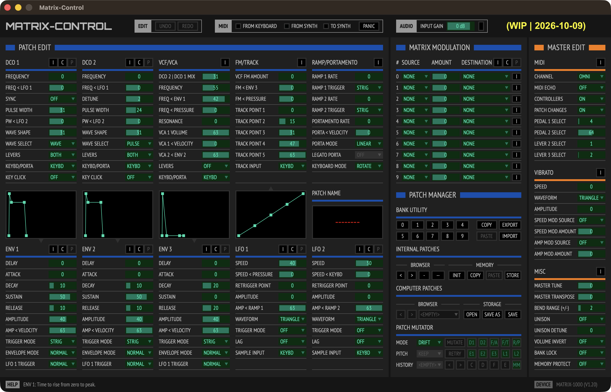

# Matrix-Control



[](https://github.com/tensquaresoftware/matrix-control)
[](https://github.com/tensquaresoftware/matrix-control)
[](https://juce.com)
[](https://github.com/tensquaresoftware/matrix-control)
[](LICENSE)
[](https://github.com/sponsors/tensquaresoftware)

> 💛 If you find this project useful or inspiring, consider [sponsoring its development](https://github.com/sponsors/tensquaresoftware) — every contribution helps keep the work going!

---

## What is Matrix-Control?

**Matrix-Control** is a cross-platform MIDI editor plugin for the Oberheim **Matrix-1000**, with support for the related **Matrix-6** and **Matrix-6R**.

The Matrix-1000 shares almost the same synthesis engine as the legendary Matrix-6 and Matrix-6R, but unlike its siblings, it has no front-panel knobs or dedicated patch editor — making it notoriously difficult to program. Matrix-Control gives you full, intuitive, real-time control over every parameter, directly from your DAW or as a standalone application.

### Supported formats

| Platform | AU | VST3 | Standalone |
|---|---|---|---|
| macOS | ✅ | ✅ | ✅ |
| Windows | — | ✅ | ✅ |
| Linux | — | ✅ | ✅ |

---

## Why this project exists — a little story

Back in 2020, a friend lent me his Matrix-1000 for an album project. He had also bought a dedicated hardware programmer for it, but found it unintuitive. I suggested building a software MIDI editor instead — and so the **Matrix-1000 Editor**, a Max for Live device, was born.

That first editor turned out to be well received by the community. It is freely available on [maxforlive.com](https://www.maxforlive.com/library/device/6806/matrix-1000-editor), and was featured in a [tutorial by Cycling '74](https://cycling74.com/tutorials/building-a-synthesizer-editor-with-javascript-part-1) (written by Jeremy Bernstein, a developer at Cycling '74 and a fellow Matrix-1000 enthusiast). It was also covered by [Audiofanzine](https://fr.audiofanzine.com/editeur-midi/tensquare/matrix-1000-editor/news/a.play,n.50627.html).

Over time, users of the Max for Live editor requested features that were difficult to implement within that environment. This led to a natural evolution: **Matrix-Control** — a full rewrite as a proper JUCE plugin, designed from the ground up with clean architecture, comprehensive documentation, and cross-platform support.

---

## Project goals

Matrix-Control is not just a plugin — it is also an attempt to provide a well-architected, thoroughly documented JUCE project can look like in practice.

Concretely, this means:

- **Clean code** — following established principles such as Clean Code, Clean Architecture, SOLID, and DRY (with thanks to Uncle Bob for the inspiration 😄)
- **Thorough technical documentation** — including a detailed technical specification, software architecture diagrams, GUI modeling, and developer guides — all written in English
- **User documentation** — a clear and complete user guide for the plugin
- **A project structure that others can learn from** — if Matrix-Control can serve as a useful reference or case study for other developers building JUCE plugins, that would be a tremendous bonus

---

## Features

Matrix-Control is a full-featured SysEx MIDI editor for the Oberheim **Matrix-1000**, with Matrix-6 / Matrix-6R support in patch-edit mode. Highlights:

### Editing & sound design

- **Complete patch editing** — every Matrix synthesis module at a glance (DCOs, VCF, VCA, LFOs, envelopes, FM/Track, ramp, portamento, and more), with real-time Remote Parameter Edit SysEx to the synth
- **Interactive Envelope displays** — drag the ENV 1 / 2 / 3 curves directly; edits write straight to the patch parameters
- **Interactive Track Generator** — five-point tracking curve you can reshape by dragging
- **Matrix Modulation** — full 10-bus matrix (source / amount / destination), with **drag-and-drop bus reordering**
- **Per-module Init / Copy / Paste** — type-aware clipboard so you only paste into compatible modules
- **Full Undo / Redo** — up to 100 editorial steps (⌘Z / Ctrl+Z), with sensible gesture grouping for sliders, envelope/Track Generator drags, and Matrix Mod reorders
- **Master Edit** (Matrix-1000) — global synth settings edited as complete Master SysEx dumps

### Patch Mutator

Inspired by Native Instruments’ Absynth mutator workflow:

- Up to **100 mutations** per patch session, and **100 retries** per mutation
- Recipe controls (amount, randomness, per-module enable toggles) that persist across sessions
- Session **history** with hierarchical Mxx / Mxx-Ryy navigation, audition, delete, and clear
- **Compare** mode to A/B the current variation against the initial snapshot
- **Export** a whole mutation session as a folder of `.syx` files (`INITIAL`, `Mxx`, `Mxx-Ryy`) ready to reopen in Computer Patches

### Patch & bank management

- **Computer Patches** — open a folder, browse, previous/next, **Save** / **Save As** as single-patch `.syx` (Edit Buffer format, safe to audition without overwriting synth RAM slots)
- **Legacy formats** — load classic **`.m1kp`** (Patch) and **`.m1km`** (Master) files from the Max for Live editor era; Save writes modern `.syx`
- **Internal Patches** — browse synth memory, INIT / COPY / PASTE / STORE, with ROM-bank gating on Matrix-1000 banks 2–9
- **Bank Utility** (Matrix-1000) — bank select 0–9, unlock, import/export full banks as `.syx`
- **Custom init templates** — save your own `PatchInit.syx` / `MasterInit.syx` as system defaults (or restore hardcoded factory inits)
- **Drag-and-drop** import for patch / bank / master `.syx` where the host OS delivers drops (see Linux note below); Open / Load paths always remain available
- **Unsaved-edit warnings** when leaving a dirty patch (policy configurable in Settings)

### MIDI reliability & hardware dialogue

- Unified outbound MIDI queue with **realtime-before-SysEx** ordering and **inter-SysEx delay** profiles keyed to the detected EPROM / firmware class — far more robust than flooding the Matrix-1000’s MIDI buffer
- Device inquiry on connect; UI stays locked until a Matrix synth is detected
- Header **activity LEDs** for keyboard / from-synth / to-synth traffic
- Configurable **hardware latency** (analog round-trip) reported to the host for correct PDC
- Standalone audio monitoring with input gain and peak indicator; hosted plugin keeps synth audio on a separate DAW track (as intended for a MIDI editor)

### Workflow & UX

- **Getting Started** first-run assistant (UI scale & skin → synth MIDI → optional keyboard / Standalone audio), with Settings control to rerun or suppress auto-open
- **Contextual HELP** — hover a control or section title to see short, on-product explanations in the footer band
- **Black** and **Cream** skins (more planned)
- **UI Scale** from 50 % to 200 % with keyboard shortcuts (no blurry global transform — layout recalculates cleanly)
- Sticky footer messages (info / success / warning / error) and live device identity
- Settings for MIDI & device, UI, reconciliation / unsaved policy, Master utilities, optional MIDI & APVTS logging
- Persistence of ports, skin, scale, folders, Mutator recipe, and preferences across sessions (patch parameters stay live with the hardware when connected)

### Platforms & distribution

AU / VST3 / Standalone as listed above; multi-platform **CI** (build + unit tests) and tag-triggered **[GitHub Releases](https://github.com/tensquaresoftware/matrix-control/releases)** for official binaries.

---

## Current status

**`1.0.0-alpha.3`** — Matrix-6/6R discovery fallback when Universal Device Inquiry times out (Master dump probe), on top of the alpha.2 Skin SSOT colour model and alpha.1 feature set: patch/master editing, Patch Mutator, Computer Patches, Bank Utility, Getting Started, contextual HELP, skins & UI scale, and CI/CD.

Still evolving toward a polished `1.0`:

- 🔄 Broader DAW / hardware validation and polish based on alpha feedback
- 🔄 English user manual (a French guide already lives in `Documentation/User/`)
- 🔜 Additional skins and further UX refinements

Binary builds: [GitHub Releases](https://github.com/tensquaresoftware/matrix-control/releases).

---

## Supporting the project

Matrix-Control is developed in my free time, alongside a day job as an instructional designer for an [Ableton-certified training center](https://fastlane.fr) in Montpellier, France. The main tool powering my development workflow is [Cursor](https://cursor.com), which has been instrumental in accelerating progress on this project — especially during the large-scale refactoring phases.

If you enjoy the Matrix-1000 Editor or Matrix-Control, sponsoring the project on [GitHub Sponsors](https://github.com/sponsors/tensquaresoftware) is the most direct way to help keep the development going. Every contribution, no matter the size, is genuinely appreciated.

Also see **[Luthier](https://github.com/tensquaresoftware/luthier)** — a Projucer-inspired desktop app for generating CMake-based JUCE plugin projects. Matrix-Control itself was bootstrapped with Luthier.

---

## Build Instructions

### Prerequisites

#### macOS

- macOS Tahoe or later
- **Cursor** or **VS Code** (with the CMake Tools and C/C++ extensions)
- CMake 3.22+
- Ninja build system
- JUCE 9.0.3 installed (set `JUCE_DIR` to your JUCE checkout, e.g. `/Volumes/Guillaume/Dev/SDKs/JUCE-9`)

#### Windows

- Windows 11 or later
- **Cursor** or **VS Code** (with the CMake Tools and C/C++ extensions)
- CMake 3.22+ (add to system PATH during installation)
- Visual Studio 2022 with "Desktop development with C++" workload
- JUCE 9.0.3 installed (set `JUCE_DIR` to your JUCE checkout, e.g. `C:\Users\Guillaume\Dev\SDKs\JUCE-9`)

### Environment Setup

Set the `JUCE_DIR` environment variable to point to your JUCE installation:

**macOS:**

```bash
export JUCE_DIR=/Volumes/Guillaume/Dev/SDKs/JUCE-9
```

**Windows:**

```
# System environment variable (recommended)
# Set via: System Properties → Environment Variables → System variables
# Name: JUCE_DIR
# Value: C:\Users\Guillaume\Dev\SDKs\JUCE-9
```

### Build

#### macOS

```bash
# Configure (using Ninja)
cmake -B Builds/macOS -G Ninja -DCMAKE_BUILD_TYPE=Debug

# Build all formats
cmake --build Builds/macOS --config Debug

# Or build specific format
cmake --build Builds/macOS --target Matrix-Control_Standalone --config Debug
cmake --build Builds/macOS --target Matrix-Control_AU --config Debug
cmake --build Builds/macOS --target Matrix-Control_VST3 --config Debug
```

#### Windows

```powershell
# Configure (using Visual Studio 2022)
cmake -B Builds/Windows -G "Visual Studio 17 2022" -DCMAKE_BUILD_TYPE=Debug

# Build all formats
cmake --build Builds/Windows --config Debug

# Or build specific format
cmake --build Builds/Windows --target Matrix-Control_Standalone --config Debug
cmake --build Builds/Windows --target Matrix-Control_VST3 --config Debug
```

#### Linux

```bash
# Configure (using Ninja)
cmake -B Builds/Linux -G Ninja -DCMAKE_BUILD_TYPE=Debug

# Build all formats
cmake --build Builds/Linux --config Debug
```

> **Note:** Audio Unit (AU) format is only available on macOS. On Windows, only VST3 and Standalone formats are built.

> **Linux drag-and-drop:** Matrix-Control’s file drop path uses JUCE’s X11/Xdnd peer. On Ubuntu/GNOME Wayland-only sessions, native file managers often never deliver OS drag-and-drop to that peer (no PATCH NAME overlay). When the OS does deliver a drop as text or a `file://` path instead of a normal file list, Matrix-Control can still load that way. Use **Computer Patches → Open** for Patch `.syx` / `.m1kp`, and **Settings → LOAD** for Master files — those paths remain the guaranteed load methods.

### Using Cursor or VS Code

1. Open the project folder in **Cursor** or **VS Code**
2. CMake Tools extension will automatically detect the project
3. Select your build kit (CMake Tools will prompt you)
4. Use the build tasks:
   - `Ctrl+Shift+P` (or `Cmd+Shift+P` on macOS) → "Tasks: Run Task"
   - Select "Build: All" or a specific format

### Plugin Installation

#### macOS

- **AU**: Copy `.component` file to `~/Library/Audio/Plug-Ins/Components/`
- **VST3**: Copy `.vst3` bundle to `~/Library/Audio/Plug-Ins/VST3/`
- **Standalone**: Run the `.app` directly

#### Windows

- **VST3**: Copy `.vst3` folder to `C:\Program Files\Common Files\VST3\`
- **Standalone**: Run the `.exe` directly

### Debugging

Debug configurations are available in `.vscode/launch.json`:

- **macOS**: Standalone, AU in Logic Pro, VST3 in Reaper, AU in Ableton Live
- **Windows**: Standalone, VST3 in Reaper

Press `F5` in **Cursor** or **VS Code** to start debugging.

---

## License

Matrix-Control source code is licensed under the
[PolyForm Noncommercial License 1.0.0](https://polyformproject.org/licenses/noncommercial/1.0.0),
with an **additional end-user grant** for official binaries. See [`LICENSE`](LICENSE).

In plain terms:

- **Official binaries** (website / GitHub Releases) are **free to use**, including for commercial music production.
- **Source code** is public so others can learn from the project (students, hobbyists, non-commercial experiments).
- **Commercial reuse of the source**, commercial redistribution, or competing products based on this work require a **separate agreement** with Ten Square Software.
- Optional support via [GitHub Sponsors](https://github.com/sponsors/tensquaresoftware) / donations is welcome and does not change these terms.

This is **source-available**, not OSI open source. Third-party fonts remain under their own licenses (see below).

---

## Fonts

Matrix-Control uses **PT Sans Narrow** (Regular and Bold) for its user interface. These fonts are licensed under the [SIL Open Font License (OFL) 1.1](https://openfontlicense.org).

- **Copyright:** © 2010, [ParaType Ltd.](https://www.paratype.com/public), with Reserved Font Names "PT Sans" and "ParaType".
- **License:** [OFL 1.1](https://scripts.sil.org/OFL) — free for use, modification, and redistribution. Full license text is available in `Assets/Fonts/OFL.txt`.

---

## About the author

Guillaume DUPONT — instructional designer, synthesizer enthusiast, and occasional developer. Based in Montpellier, France.

- [Matrix-1000 Editor (Max for Live)](https://www.maxforlive.com/library/device/6806/matrix-1000-editor)
- [Matrix-1000 Editor Presentation at Montpellier Ableton User Group / FASTLANE (YouTube)](https://www.youtube.com/watch?v=DLOBp0x1ykY)
- [FASTLANE (Instructional Designer)](https://fastlane.fr/notre-equipe/guillaume-dupont/)
- [LinkedIn](https://www.linkedin.com/in/guillaumedupontmontpellier/)
